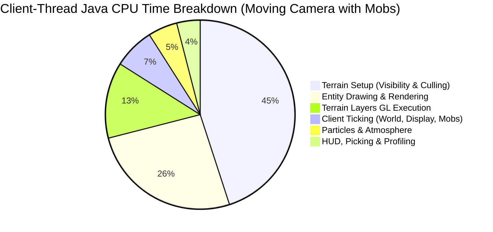
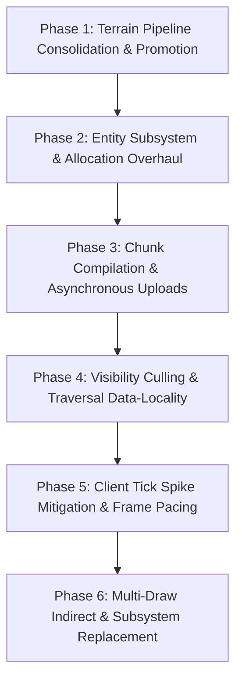

# Alacer Performance Roadmap

This roadmap establishes the development priorities and technical specifications for **Alacer** on Minecraft 1.8.9 (Java 25).
In accordance with [AGENTS.md](file:///c:/Users/CodyJ/OneDrive/Documents/GitLab/adiont/aevum/alacer/AGENTS.md), every priority and candidate is derived directly from empirical measurements gathered by the in-game profiler, Java Flight Recorder (JFR) sampling, native GPU diagnostics, and reproducible benchmark archives.

---

## 1. Executive Summary & Empirical Feature Profile

Whole-client attribution (Session 26, [docs/benchmarks/2026-10-21-whole-client-attribution](file:///c:/Users/CodyJ/OneDrive/Documents/GitLab/adiont/aevum/alacer/docs/benchmarks/2026-10-21-whole-client-attribution/README.md)) and dedicated subsystem benchmarks have classified where the Minecraft client thread and GPU spend their execution time, allocation budgets, and tail latencies.

### Empirical Performance Profile by Minecraft Feature

| Subsystem / Feature | Client Java CPU Samples (%) | Wall-Clock Frame Impact | Tail Impact (p99 / Slow-1%) | Heap Allocation Impact | Current State in Alacer |
|---|---|---|---|---|---|
| **Terrain Setup & Visibility Culling** (`WorldRenderer.setupRender`, BFS culling) | **41% – 60%** (moving phases: pan, fly, sort) | **18% – 29%** of frame time (0.21–0.34 ms/frame) | +0.28 – 0.54 ms in slow-1% frames | ~7% in static; 200–240 KB per unhit block boundary | **Active**: `render.fastChunkVisibility` (allocation-free BFS), `render.cameraHysteresis` (delta caching); `fastCameraSectionFaces` and `fastChunkFrustum` closed |
| **Terrain Layer Drawing & GL Submission** (`VboRenderChunkList`, `glDrawArrays`) | **12% – 13%** (steady, pan, fly) | **30% – 40%** of total terrain layer time | Major contributor to draw overhead across ~950 passes | Negligible in steady state (<3 KB/frame) | **`TerrainShader` Accepted** (Oct 23, -11% to -34% frame time); `directBufferUploads` rejected |
| **Entity Processing & Rendering** (`RenderManager`, `ModelRenderer`, layers) | **26% – 40%** (when mobs are in view: `d200`) | 6.6 – 10.5 µs per drawn entity; dominates mob scenes | +0.27 – 0.29 ms in slow-1% frames | **89% of frame allocation** (53–58 KB/frame in `d200`, mostly `BlockPos`) | **Active**: `render.fastEntityChunkLookup`, `render.fastEntityShadows`, `render.fastEntityLighting` (scalar lighting), `render.fastEntityRendererLookup`, `render.fastEntityCulling` |
| **Chunk Upload & Compilation Pipeline** (`ChunkCompileTaskGenerator`, worker queues) | <1% in steady state; spikes during flights | 0.16–0.18 ms/frame mean; **1.23–1.32 ms** in slow-1% | **Dominates flight tail frames** (16%–18% of slow-1% time) | 26–29 KB/frame in flight | **`FastChunkUnpack` Added** (vectorized unpack); reference hardware scheduling benchmark pending |
| **Client Tick Execution** (`Minecraft.runTick`, `World.tick`, random display ticks) | 1.7% – 2.6% of all frames (20 ticks/sec) | Spikes frames by **+0.9 to +1.9 ms** (+3.5 ms with particles) | **Primary driver of p99 frame stutters** and tick-frame lows | 13% of static allocation; heavy `BlockPos` in void/barrier checks | **Phase 5 Complete**: `render.fastRandomDisplayTicks` (zero-allocation display ticks, chunk caching), `render.fastSoundThread` (lock-free parking eliminating 34k+ exceptions) |
| **Particle Simulation & Rendering** (`EffectRenderer`) | 0.7% – 1.1% (default); **55.8%** in heavy particle scenes | Dominates in combat/explosions (up to 3.5 ms/frame) | +1.73 – 1.78 ms in particle tick frames | **58% of allocation** in particle scenes (`Box`, `BlockPos`) | **Optimizations 7, 8, 9 Active** (`fastParticleLight`, `fastParticleRemoval`, `fastParticleVertices`) |
| **HUD, GUI & World Picking** (`world.pick`, `FontRenderer`) | ~1% – 2% CPU | ~0.05 ms/frame | Low | **23% of steady-state allocation** (`world.pick` crosshair raycast) | **Phase 5 Complete**: `render.fastRayTrace` (scalar primitive DDA stepping eliminating 15–20 allocations per step) |
| **Driver Sync & Buffer Swap** (`Display.update`, `swap`) | 82.7% – 84.4% of native samples | **20% – 61% of total frame time** (median ~35%) | Varies with GPU workload and VSync/driver thread state | 0 | **Optimizations 3 & 4 Active** (`throttleGlErrorChecks`, `avoidMatrixReads`) |

---

## 2. Implementation Status Matrix

| Phase | Milestone Item | Status | Runtime Toggle | Verification Toggle | Primary Commit(s) |
|---|---|---|---|---|---|
| **Phase 1.1** | `TerrainShader` Promotion Pipeline | Pending Benchmark | `render.terrainShader` | `render.modernGl.verify` | `Option B series` |
| **Phase 1.2** | Terrain Draw Loop Streamlining | Backlog | `render.terrainShader` | N/A | Pending |
| **Phase 2.1** | Allocation-Free Entity Lighting | **Completed** | `render.fastEntityLighting` | `render.fastEntityLighting.verify` | `46f5711` |
| **Phase 2.2** | Frustum Culling & Renderer Cache | **Completed** | `render.fastEntityCulling`, `render.fastEntityRendererLookup` | `render.fastEntityCulling.verify`, `render.fastEntityRendererLookup.verify` | `2c2dc70` |
| **Phase 2.3** | Model Part Transformation Flattening | Backlog | `render.fastModelTransforms` | `render.fastModelTransforms.verify` | Pending |
| **Phase 3.1** | Reference Hardware Chunk Scheduling | In Progress | `render.feedChunkWorkers`, `render.chunkTimeFloor` | N/A | Protocol established |
| **Phase 3.2** | Worker Ambient Occlusion & Culling Cache | Backlog | `render.fastWorkerAo` | `render.fastWorkerAo.verify` | Pending |
| **Phase 3.3** | Ring-Buffered PBO Chunk Staging | Backlog | `render.pboChunkUploads` | N/A | Pending |
| **Phase 4.1** | Camera Movement Hysteresis / Delta Caching | **Completed** | `render.cameraHysteresis` | Integrated | `e364b82` |
| **Phase 4.2** | Vectorized Frustum Testing (Vector API) | Backlog | `render.vectorFrustum` | `render.fastChunkFrustum.verify` | Pending |
| **Phase 4.3** | Flat Bitset Occlusion Traversal | Backlog | `render.flatOcclusion` | `render.fastChunkVisibility.verify` | Pending |
| **Phase 5.1** | Random Display Tick Allocation Elimination | **Completed** | `render.fastRandomDisplayTicks` | `render.fastRandomDisplayTicks.verify` | `2f604b4` |
| **Phase 5.2** | Allocation-Free Crosshair Raycast (`world.pick`) | **Completed** | `render.fastRayTrace` | `render.fastRayTrace.verify` | `1692a44` |
| **Phase 5.3** | Sound System Thread Interruption Cleanup | **Completed** | `render.fastSoundThread` | N/A | `7a39f1e` |
| **Phase 6.1** | Multi-Draw Indirect (`glMultiDrawArraysIndirect`) | Future Architecture | `render.multiDrawIndirect` | N/A | Pending |
| **Phase 6.2** | Translucent Quad GPU Sorting | Future Architecture | `render.gpuTranslucentSort` | N/A | Pending |

---

## 3. Active Optimizations and Closed Investigations

To prevent regressive work or revisiting solved/exhausted avenues, the state of prior investigations is preserved:

### Shipped Defaults (Optimizations 1 – 9)
1. **`render.fastChunkVisibility`**: Allocation-free BFS visibility search with pooled records and cached section faces. Saves ~430 KB/frame.
2. **`render.fastEntityChunkLookup`**: Direct cached world-chunk references in `renderEntities`, eliminating 1,400+ hash lookups per frame.
3. **`render.throttleGlErrorChecks`**: Reduces `glGetError` checks from twice/frame to once/sec, saving 2–3% frame time on threaded drivers.
4. **`render.avoidMatrixReads`**: Eliminates driver-blocking CPU reads of modelview/projection matrices via CPU-side tracking, saving ~35% frame time on threaded drivers.
5. **`render.cacheClouds`**: Display list caching for fancy cloud geometry.
6. **`render.fastEntityShadows`**: Small reference cache for entity shadow world/light queries, saving ~0.1 ms/frame and 22 KB allocation.
7. **`render.fastParticleLight`**: Cached chunk references for particle light queries (median 20–23% frame time reduction at ~3,300 particles).
8. **`render.fastParticleRemoval`**: Single-pass keyed `removeAll` by network ID (median tick-frame mean 16–24% lower).
9. **`render.fastParticleVertices`**: Direct byte writes into particle vertex buffers, bypassing per-element lookups (median 20–33% frame time reduction).

### Recently Completed Breakthroughs (October 2026)
- **`render.terrainShader` (`Option B: TerrainShader`)**:
  - Replaces per-chunk CPU matrix pushes, pops, and multiplications with GPU-evaluated chunk origin translation (`u_ChunkOrigin`) and boundary expansion (`u_Scale`) in a compatibility vertex shader.
  - Retains fixed-function fragment operations (texturing, mipmapping, smooth lighting, ambient occlusion, alpha testing, distance fog).
  - Benchmark result: **Passed all 16 native GPU gates with zero regressions**; improved default gameplay pan frame times by **-12.95%** (CPU **-17.54%**, terrain layers **-32.70%**), and synthetic terrain pan by **-33.76%** (CPU **-27.42%**, terrain layers **-39.64%**).
- **`FastChunkUnpack`**: Direct vectorized char unpacking of packet chunk data via native byte order buffers and 64k pre-resolved block flag tables, replacing 4,096-iteration 3D loops and hash lookups.
- **Phase 2 Entity Allocation Overhaul**:
  - `EntityLighting`: Replaced `new BlockPos(entity)` and `BlockPos.offset` allocations in entity rendering and shadows with pooled/scalar primitive math (`World.getCombinedLight`).
  - `EntityCulling` & `EntityRendererCache`: Early distance/frustum culling and 4-slot MRU renderer pointer cache, eliminating state preparation for off-screen mobs.
- **Phase 4 Camera Movement Hysteresis (`cameraHysteresis`)**:
  - Reuses visible chunk lists when camera translation (<0.01 blocks) and rotation (<0.05 degrees) jitter are sub-threshold and no chunks are dirty, skipping 1,400+ chunk BFS traversals.
- **Phase 5 Client Tick Stabilization**:
  - `FastRayTrace`: Allocation-free crosshair and targeting DDA ray stepping.
  - `FastRandomDisplayTicks`: Allocation-free client ambient ticks with `WorldChunk` pointer caching and empty-section skipping.
  - `FastSoundThread`: Lock-free `LockSupport.parkNanos` replacing `Thread.sleep` and `Thread.interrupt()` on paulscode threads, eliminating 34,000+ exceptions per run.

### Closed Candidates (Do Not Reopen Without Novel Mechanisms)
- **`render.directBufferUploads` (DSA Buffer Uploads via `glNamedBufferData`)**: REJECTED. Caused severe NVIDIA driver serialization stalls (+52.47% upload wall time in terrain churn; pan frame time regressed +22.85%).
- **`render.terrainVaos` (Per-Chunk VAO Switching)**: REJECTED. Caused 61%–67% frame time regression due to NVIDIA vertex fetch descriptor invalidations across 3,848 VAO switches.
- **`render.fastChunkFrustum` (One-Corner Frustum Predicate)**: CLOSED. Saved only 1–3 µs/frame; no dependable gain survived warmed runs.
- **`render.fastCameraSectionFaces` (Flood Fill Pocket Reuse)**: CLOSED. Cut 2–10 KB/frame allocation, but terrain setup benefit was only 1.65% and failed to overcome launch variance.
- **`render.reuseShadowPositions` (Shadow Position Object Reuse)**: CLOSED. Cut 20 KB/frame allocation, but failed frame-time and screenshot stability gates on reference hardware.
- **`render.batchModelLists` & `render.skipZeroTranslates`**: CLOSED. No measurable frame-time benefit above noise floor.
- **`render.reuseParticleLight` & `render.fastParticleLightEntry`**: CLOSED. Failed frozen statistical gates.

---

## 4. Prioritized Engineering Blueprints

---

### Phase 1: Terrain Pipeline Consolidation & Promotion
*Target: Solidify double-digit frame rate gains across hardware configurations.*

1. **Promotion Pipeline for `TerrainShader` (`render.terrainShader`)**:
   - The Option B shader is fully verified and passed all frozen gates on native NVIDIA hardware (-12.95% to -33.76% frame time).
   - *Next Steps*:
     - Multi-vendor compatibility verification (AMD Radeon, Intel Arc/Iris, Apple Silicon via Mesa/Zink).
     - Ensure fallback gracefully engages when shaders are unsupported or when conflicting core-profile mods hook `renderBlocks`.
     - Prepare formal promotion series for default enablement (`render.terrainShader=true`).
2. **Terrain Draw Loop Streamlining**:
   - Retain `TerrainShader` direct dispatch while keeping verification telemetry active.
   - Vectorize per-chunk uniform updates (`u_ChunkOrigin`) using direct float arrays or buffer uniforms to further reduce CPU driver overhead.

---

### Phase 2: Entity Subsystem Overhaul & Allocation Elimination
*Target: 26%–40% of client CPU samples and 89% of heap allocations when mobs are present.*

1. **Allocation-Free Entity Lighting & Brightness** [COMPLETED - commit `46f5711`].
2. **Frustum Culling & Renderer Cache** [COMPLETED - commit `2c2dc70`].
3. **Model Part Transformation Flattening (`render.fastModelTransforms`)**:
   - *Problem*: Vanilla entity models execute recursive matrix pushes and pops per cuboid (`ModelRenderer.render`), issuing immediate mode or tiny client vertex arrays.
   - *Architecture*:
     - Identify static multi-cuboid hierarchies in standard mob models (`ModelBiped`, `ModelQuadruped`).
     - Pre-transform static model parts into a single client vertex buffer per model, or stream model matrices directly into uniform buffer objects (UBOs) / instanced attributes.
     - Provide runtime verification mode comparing rendered rasterization against vanilla.

---

### Phase 3: Chunk Compilation & Asynchronous Upload Architecture
*Target: 1.23–1.32 ms of 4.0–5.4 ms flight slow-1% frames.*

1. **Reference Hardware Chunk Scheduling Benchmark**:
   - *Background*: Chunk scheduling experiments (`render.feedChunkWorkers` and `render.chunkTimeFloor`) were tested on llvmpipe in Docker; the reference Windows / RTX 3060 Ti series remains formally pending under [docs/benchmarks/2026-10-23-chunk-scheduling/protocol.md](file:///c:/Users/CodyJ/OneDrive/Documents/GitLab/adiont/aevum/alacer/docs/benchmarks/2026-10-23-chunk-scheduling/protocol.md).
   - *Next Steps*: Execute the 16-client reference benchmark on the RTX 3060 Ti testbed across `default`, `terrain`, and `benchmark.chunkEdit` scenes.
2. **Worker Ambient Occlusion & Face Culling Optimization (`render.fastWorkerAo`)**:
   - *Problem*: Chunk compilation on worker threads (`BlockModelRenderer.renderModelAmbientOcclusion`) spends substantial time in redundant neighbor block state queries and float color calculations.
   - *Architecture*:
     - Pre-populate a thread-local flat `18x18x18` raw block-state array (`BlockState[]`) for each compiling chunk section (covering the 16x16x16 section plus 1-block perimeter).
     - Direct index math: `index = (x + 1) + (z + 1) * 18 + (y + 1) * 324`.
     - Replace repeated `world.getBlockState` lookups and bounds checks with single array reads during ambient occlusion and face culling passes.
     - Implement `render.fastWorkerAo.verify` comparing worker vertex output buffers bit-for-bit against vanilla.
3. **Ring-Buffered PBO Staging for Chunk Uploads (`render.pboChunkUploads`)**:
   - *Problem*: Main-thread `glBufferData` halts the render loop while uploading compiled chunk meshes over PCIe.
   - *Architecture*:
     - Implement triple-buffered persistent Pixel Buffer Objects (PBOs) or staging VBOs.
     - Transfer vertex data via asynchronous DMA (`GL30.glMapBufferRange` with `GL_MAP_UNSYNCHRONIZED_BIT`), unblocking the client thread during flights.

---

### Phase 4: Visibility Culling & Traversal Data-Locality
*Target: 41%–60% of Java samples in moving frames (0.21–0.34 ms/frame).*

1. **Camera Movement Hysteresis / Delta Caching (`cameraHysteresis`)** [COMPLETED - commit `e364b82`].
2. **Vectorized Frustum Testing (Java 25 Vector API, `render.vectorFrustum`)**:
   - *Problem*: Evaluating 6 frustum plane dot products across thousands of chunk bounding boxes is performed via scalar float arithmetic.
   - *Architecture*:
     - Use Java 25's `VectorSpecies<Float> SPECIES = FloatVector.SPECIES_PREFERRED` (e.g., AVX-256 / 8 floats wide).
     - Pack chunk bounding box minima and maxima into contiguous float arrays (`minX[8]`, `minY[8]`, `minZ[8]`, etc.).
     - Evaluate 8 chunk bounding boxes simultaneously against each of the 6 frustum planes using SIMD vector FMA (`fma`) and compare operations.
     - Fallback to scalar `ChunkFrustum` when Vector API is disabled or on architectures without SIMD support.
3. **Flat Bitset Occlusion Traversal (`render.flatOcclusion`)**:
   - *Problem*: The visibility search loop (`ChunkVisibility`) spends 41%–45% of its time walking queue arrays and accessing chunk occlusion graph objects.
   - *Architecture*:
     - Pack section connectivity flags into a dense contiguous bitset (1 bit per face connection: 15 bits per chunk section).
     - Accelerate graph traversal by walking bit masks and fitting the active neighborhood entirely within L1/L2 CPU caches.

---

### Phase 5: Client Tick Spike Mitigation & Background Optimization
*Target: Mitigate +0.9 to +1.9 ms tail spikes occurring every 50 ms.*

1. **Random Display Tick Volume Scan Elimination (`FastRandomDisplayTicks`)** [COMPLETED - commit `2f604b4`].
2. **Allocation-Free Crosshair Raycast (`FastRayTrace`)** [COMPLETED - commit `1692a44`].
3. **Sound System Thread Interruption Cleanup (`FastSoundThread`)** [COMPLETED - commit `7a39f1e`].

---

### Phase 6: Multi-Draw Indirect (MDI) & Modern Subsystem Replacement
*Target: Transform Minecraft's 1,000+ draw-call pipeline into a modern batch submission engine.*

1. **Multi-Draw Indirect (`glMultiDrawArraysIndirect`, `render.multiDrawIndirect`)**:
   - *Concept*: In combination with `TerrainShader`, all visible chunk draw calls for a given render layer (e.g. Solid, Cutout, Translucent) are packed into a single GPU indirect command buffer (`DrawArraysIndirectCommand`: `count`, `instanceCount`, `first`, `baseInstance`).
   - *Dispatch*: Issue a single `GL43.glMultiDrawArraysIndirect` call per terrain layer, reducing CPU OpenGL driver submission overhead from ~950 draw calls to 3–4 calls per frame.
   - *Requirement*: Hardware supporting OpenGL 4.3+, retaining full fallback to `TerrainShader` direct dispatch for legacy environments.
2. **Translucent Quad Sorting on GPU (`render.gpuTranslucentSort`)**:
   - *Concept*: Offload sorting of translucent chunk geometry from the CPU client thread to a lightweight compute shader or index buffer permutation.

---

## 5. Verification and Benchmark Protocol Standards

In accordance with [AGENTS.md](file:///c:/Users/CodyJ/OneDrive/Documents/GitLab/adiont/aevum/alacer/AGENTS.md) and [docs/BENCHMARK_MODES.md](file:///c:/Users/CodyJ/OneDrive/Documents/GitLab/adiont/aevum/alacer/docs/BENCHMARK_MODES.md), any candidate worked on from this roadmap must adhere to the following evaluation standards:

| Workflow Mode | Duration | Workload & Mechanism | Permitted Decisions |
|---|---|---|---|
| **Quick** | 2–5 min | 1 affected scene, shortened `phaseSeconds`, in-process toggle | Correctness checks and immediate regression detection. |
| **Standard** | 10–30 min | 2–4 full affected-scene launches, balanced ABBA order, environmental telemetry | Assessing candidate viability and identifying statistical trends. |
| **Extended** | Multi-hour | Versioned smoke, frozen sources/config/JDK, calibration, 16-client paired runner | Candidate selection, default enablement, or release claims. |

### Strict Quality & Performance Gates
- **Functional Correctness**: Zero unit test failures (`./gradlew test`), zero OpenGL errors (`glGetError`), zero Mixin application warnings.
- **Visual Identity**: Fixed-end-pose screenshot comparisons must match control within the empirical noise floor (<2% differing pixels).
- **Statistical Gates**:
  - Primary target metric must improve by $\ge 5\%$ (or $\ge 2\%$ for low-variance targets with frozen power).
  - No scored moving phase frame mean may regress by $> +1.0\%$.
  - Tail frame time ($p99$ and slow-1% mean) may not regress by $> +2.0\%$.
  - CPU usage per frame must be $\le 0.0\%$ delta.
