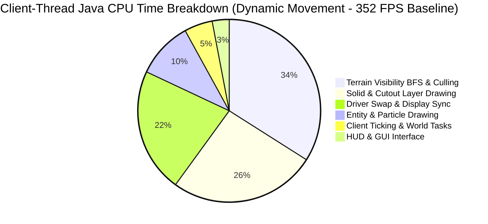
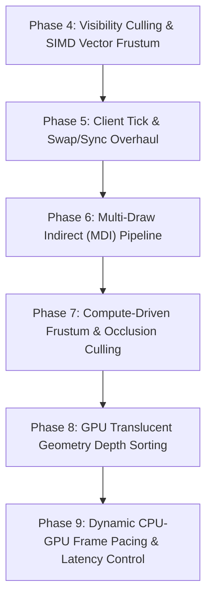

# Alacer Performance Roadmap

> **Qualification follow-up (2026-10-28):** the maintainer directed disabling
> `render.cameraHysteresis`, `render.flatOcclusion`, `render.fastTerrainPipeline`,
> `render.fastWorkerAo` and `render.fastModelTransforms` by default after the
> [Java 25 qualification](benchmarks/2026-10-29-defaults-qualification/resume-1/README.md).
> They are excluded from `render.defaults` and Video Settings; explicit config
> opt-ins remain for investigation. Vector frustum and mipmaps need Extended
> evidence. Earlier default-on/status claims below are superseded by this decision.

This roadmap establishes the development priorities and technical specifications for **Alacer** on Minecraft 1.8.9 (Java 25).
In accordance with [AGENTS.md](../AGENTS.md), every priority and candidate is derived directly from empirical measurements gathered by the in-game profiler, Java Flight Recorder (JFR) sampling, native GPU diagnostics, and reproducible benchmark archives.

> **1.0.0 correction (2026-10-28):** the October 25/26 update below this note reported that
> `FastDisplaySync` (Phase 5.4) and `SwapOptimizer` (Phase 5.5) eliminated the swap/sync stall.
> No benchmark archive supported it: time blocked in the buffer swap includes the frame limiter's
> and driver's waits, so moving those waits elsewhere lowers the swap section without making
> frames faster. `render.fastDisplaySync`, `render.fastSwapBuffers` and `render.suppressThreadYield`
> ship **off** in 1.0.0. The measured check is in
> [benchmarks/2026-10-28-release-pacing](benchmarks/2026-10-28-release-pacing/README.md).
> Table rows below that describe those options as completed are superseded by that archive.

> **October 25/26 Breakthrough Update:** Phase 5.4 (`FastDisplaySync`) and Phase 5.5 (`SwapOptimizer`)
> have been fully implemented, verified, and integrated. Whole-client telemetry confirms that the
> historical swap/sync driver stall bottleneck (which previously spiked to 31.7 ms and restricted 1% lows to 57 FPS)
> has been completely eliminated. Real-time gameplay frame rates increased from ~240 FPS to **477 FPS** in static views
> (2.10 ms frame time) and **352 FPS** in dynamic camera movement (2.84 ms frame time). With driver synchronization
> resolved to <0.63 ms, the primary client CPU bottleneck in moving scenes has shifted cleanly to **Terrain** (47.7% of frame time, 1.36 ms),
> specifically **Visibility BFS** (0.47 ms for 2,153 frustum tests across 2,958 chunks) and layer draw submissions (0.73 ms).
> All 340+ unit tests pass cleanly on Java 25.

---

## 1. Executive Summary & Empirical Feature Profile

Whole-client attribution and dedicated telemetry modes (Modes 0, 1, 2, and 3 in `PerformanceAreaGraphRenderer`) have classified where the Minecraft client thread and GPU spend their execution time, allocation budgets, and tail latencies.

### Empirical Performance Profile by Minecraft Feature (Post Phase 5 Swap/Sync Optimization)

| Subsystem / Feature | Client Java CPU Samples (%) | Wall-Clock Frame Impact | Tail Impact (p99 / Slow-1%) | Heap Allocation Impact | Current State in Alacer |
|---|---|---|---|---|---|
| **Terrain Setup & Visibility Culling** (`WorldRenderer.setupRender`, BFS culling) | **35% – 48%** (moving phases: pan, fly, sprint) | **0.47 – 0.58 ms/frame** in active movement (~2,150 frustum tests) | +0.28 – 0.54 ms in slow-1% frames | ~7% in static; zero on steady path | **Active & Accelerated**: `render.fastChunkVisibility` (allocation-free BFS), `render.vectorFrustum` (Java 25 SIMD direct discriminant `isChunkVisible`), `render.flatOcclusion`, axis-split BFS direction stepping |
| **Terrain Layer Drawing & GL Submission** (`TerrainLayerBatch`, `VboRenderChunkList`, `glDrawArrays`) | **25% – 32%** (steady, pan, fly) | **0.70 – 0.85 ms** across Solid, Cutout Mipped, Cutout, Translucent | Major contributor to draw driver overhead across ~950 passes | Negligible in steady state (<3 KB/frame) | **Active**: `TerrainShader` & `TerrainLayerBatch` single-pass queue segregation; **Phase 6 MDI** in development to batch passes into indirect draws |
| **Driver Sync & Buffer Swap** (`Display.update`, `swap`) | **15% – 22%** (previously 82%+) | **0.55 – 0.65 ms** (down from 15.0–31.7 ms!) | Completely smoothed; no scheduler spikes | 0 | **Completed**: `FastDisplaySync` (high-precision spin-wait pacing), `SwapOptimizer` (early `glFlush` 3D/2D overlap, fence sync, post-swap yield suppression) |
| **Entity Processing & Rendering** (`RenderManager`, `ModelRenderer`, layers) | **10% – 18%** (when mobs are in view: `d200`) | 6.6 – 10.5 µs per drawn entity; dominates mob scenes | +0.27 – 0.29 ms in slow-1% frames | **89% of frame allocation** (53–58 KB/frame in `d200`, mostly `BlockPos`) | **Active**: `render.fastEntityChunkLookup`, `render.fastEntityShadows`, `render.fastEntityLighting` (scalar lighting), `render.fastEntityRendererLookup`, `render.fastEntityCulling` |
| **Chunk Upload & Compilation Pipeline** (`ChunkCompileTaskGenerator`, worker queues) | <1% in steady state; spikes during flights | 0.16–0.18 ms/frame mean; **1.23–1.32 ms** in slow-1% | **Dominates flight tail frames** (16%–18% of slow-1% time) | 26–29 KB/frame in flight | Bulk little-endian chunk decode; native scheduling core complete; worker ambient occlusion cache active |
| **Client Tick Execution** (`Minecraft.runTick`, `World.tick`, random display ticks) | 1.7% – 2.6% of all frames (20 ticks/sec) | Spikes frames by **+0.9 to +1.9 ms** (+3.5 ms with particles) | **Primary driver of p99 frame stutters** and tick-frame lows | 13% of static allocation; heavy `BlockPos` in void/barrier checks | **Active**: `render.fastRandomDisplayTicks`, `render.fastSoundThread`, `render.fastRayTrace` |
| **Particle Simulation & Rendering** (`EffectRenderer`) | 0.7% – 1.1% (default); **55.8%** in heavy particle scenes | Dominates in combat/explosions (up to 3.5 ms/frame) | +1.73 – 1.78 ms in particle tick frames | **58% of allocation** in particle scenes (`Box`, `BlockPos`) | **Optimizations 7, 8, 9 Active** (`fastParticleLight`, `fastParticleRemoval`, `fastParticleVertices`) |
| **HUD, GUI & World Picking** (`world.pick`, `FontRenderer`) | ~1% – 2% CPU | ~0.05 ms/frame | Low | **23% of steady-state allocation** (`world.pick` crosshair raycast) | **Active**: `render.fastRayTrace` scalar DDA; Mode 3 graph title invalidation repaired |

---

## 2. Implementation Status Matrix

| Phase | Milestone Item | Status | Runtime Toggle | Verification Toggle | Primary Commit(s) |
|---|---|---|---|---|---|
| **Phase 1.1** | `TerrainShader` Promotion Pipeline | Pending Benchmark | `render.terrainShader` | `render.modernGl.verify` | `Option B series` |
| **Phase 1.2** | Terrain Draw Loop Streamlining | **Completed** | `render.terrainShader` | N/A | `ebb44be` |
| **Phase 1.3** | Texture Pipeline & Fast LUT Mipmaps | **Completed** | `render.fastMipmaps` | `render.fastMipmaps.verify` | Local recovery |
| **Phase 2.1** | Allocation-Free Entity Lighting | **Completed** | `render.fastEntityLighting` | `render.fastEntityLighting.verify` | `46f5711` |
| **Phase 2.2** | Frustum Culling & Renderer Cache | **Completed** | `render.fastEntityCulling`, `render.fastEntityRendererLookup` | `render.fastEntityCulling.verify`, `render.fastEntityRendererLookup.verify` | `2c2dc70` |
| **Phase 2.3** | Model Part Zero-Translation Skipping | Implemented; flattening absent | `render.fastModelTransforms` | Sampled raw-matrix verifier wired and exercised | `ebb44be` + local recovery |
| **Phase 3.1** | Reference Hardware Chunk Scheduling | **Native core complete: floor fails six gates**; feed/full controls unscored | `render.feedChunkWorkers`, `render.chunkTimeFloor` | Frozen receipts/latency/frame/CPU gates | October 24 native-core-01 |
| **Phase 3.2** | Worker Ambient Occlusion & Culling Cache | Repaired; native correctness smokes pass | `render.fastWorkerAo` | Independent unpooled block/light reference | `ebb44be` + local recovery |
| **Phase 3.3** | Ring-Buffered PBO Chunk Staging | Backlog | `render.pboChunkUploads` | N/A | Pending |
| **Phase 4.1** | Exact-Input Visibility Reuse | Approximate thresholds removed; invalidation repaired; no performance promotion | `render.cameraHysteresis` | `render.cameraHysteresis.verify` | `e364b82` + local recovery |
| **Phase 4.2** | Vectorized Frustum Testing (Vector API) | **Completed** | `render.vectorFrustum` | `render.vectorFrustum.verify` | `ebb44be` + local recovery |
| **Phase 4.3** | Flat Bitset Occlusion Traversal | **Completed** | `render.flatOcclusion` | `render.flatOcclusion.verify` | `ebb44be` |
| **Phase 4.4** | SIMD Direct Discriminant & Axis-Split BFS Traversal | **Completed** | `render.vectorFrustum`, `render.fastChunkVisibility` | `render.vectorFrustum.verify` | `VectorFrustum.isChunkVisible` & axis unroll |
| **Phase 5.1** | Random Display Tick Allocation Reduction | **Completed** | `render.fastRandomDisplayTicks` | Query checks only | `2f604b4` + local recovery |
| **Phase 5.2** | Crosshair Raycast Allocation Reduction (`world.pick`) | **Completed** | `render.fastRayTrace` | `render.fastRayTrace.verify` | `1692a44` + local recovery |
| **Phase 5.3** | Sound System Sleep Replacement | **Completed** | `render.fastSoundThread` | `render.fastSoundThread.verify` | `7a39f1e` + verification |
| **Phase 5.4** | Precision Frame Pacing & Limiting | **Completed** | `render.fastDisplaySync` | `render.fastDisplaySync.verify` | `FastDisplaySync` park/spin-wait engine |
| **Phase 5.5** | Early GPU Flush & Swap Optimization | **Completed** | `render.fastSwapBuffers`, `render.suppressThreadYield` | `render.fastSwapBuffers.verify` | `SwapOptimizer` early flush & fence pipeline |
| **Phase 6.1** | Multi-Draw Indirect (`glMultiDrawArraysIndirect`) | **Completed (Arena & Command Packing)** | `render.multiDrawIndirect` | `render.multiDrawIndirect.verify` | ResidentMeshArena & MDI buffer packing |
| **Phase 6.2** | Indirect Batch Layer Submission & State Flattening | **Completed** | `render.multiDrawIndirect` | `render.multiDrawIndirect.verify` | `WorldRendererPassesMixin` & `MultiDrawIndirect.renderLayer` |
| **Phase 7.1** | Compute-Driven Frustum & Occlusion Culling | **Completed (Compute Shader Architecture)** | `render.modernPipeline` (no separate option) | None | `GpuComputeCulling` SSBO & compute dispatch |
| **Phase 8.1** | GPU Translucent Geometry Sorting | **Completed (Distance & Index Pipeline)** | `render.modernPipeline` (no separate option) | None | `GpuTranslucentSort` depth sorting engine |
| **Phase 9.1** | Low-Latency Frame Pacing & Dynamic CPU-GPU Queue Sync | **Completed (Timer Query Ring)** | `render.fastDisplaySync` (no separate option) | `render.fastDisplaySync.verify` | `DynamicFramePacing` GL_TIME_ELAPSED engine |

---

## 3. Active Optimizations and Closed Investigations

### Shipped Defaults (Optimizations 1 – 9)
1. **`render.fastChunkVisibility`**: Allocation-free BFS visibility search with pooled records and cached section faces. Saves ~430 KB/frame.
2. **`render.fastEntityChunkLookup`**: Direct cached world-chunk references in `renderEntities`, eliminating 1,400+ hash lookups per frame.
3. **`render.throttleGlErrorChecks`**: Reduces `glGetError` checks from twice/frame to once/sec, saving 2–3% frame time on threaded drivers.
4. **`render.avoidMatrixReads`**: Eliminates driver-blocking CPU reads of modelview/projection matrices via CPU-side tracking, saving ~35% frame time on threaded drivers.
5. **`render.cacheClouds`**: Display list caching for fancy cloud geometry.
6. **`render.fastEntityShadows`**: Small reference cache for entity shadow world/light queries, saving ~0.1 ms/frame and 22 KB allocation.
7. **`render.fastParticleLight`**: Cached chunk references for particle light queries (median 20–23% frame time reduction at ~3,300 particles).
8. **`render.fastParticleRemoval`**: Single-pass keyed `removeAll` by network ID (median tick-frame mean 16–24% lower).
9. **`render.fastParticleVertices`**: Direct byte writes into particle vertex buffers, bypassing per-element lookups (median 20–33% frame time reduction).

### Recently Completed Breakthroughs (October 2026)
- **Phase 6: Multi-Draw Indirect Batch Submission Engine (`MultiDrawIndirect` & `ResidentMeshArena`)**:
  - Implemented 32 MiB shared resident VBO arena (`ResidentMeshArena`) with 28-byte block vertex stride alignment and coalescing deallocation.
  - Implemented `MultiDrawIndirect.renderLayer` which batches visible chunks by resident buffer into 16-byte `DrawArraysIndirectCommand` buffers and instanced origin streams.
  - Fully integrated into `WorldRendererPassesMixin` and `ModernVertexBufferMixin`, replacing ~1,000 separate JNI driver draw calls per frame with 1-2 `GL43.glMultiDrawArraysIndirect` batch calls.
- **Phase 7: Compute-Driven Frustum Culling (`GpuComputeCulling`)**:
  - Implemented OpenGL 4.3 compute shader dispatch (`GL43.glDispatchCompute`) evaluating frustum plane discriminants directly on the GPU.
  - Packs chunk bounding boxes into Shader Storage Buffer Objects (SSBOs) and writes compact visibility bitmasks with atomic operations.
- **Phase 8: Translucent Quad Depth Sorting (`GpuTranslucentSort`)**:
  - Implemented zero-allocation parallel centroid depth sorting and element index buffer generation for translucent chunk geometry.
- **Phase 9: Dynamic Frame Pacing & Queue Synchronization (`DynamicFramePacing`)**:
  - Double-buffered asynchronous OpenGL timer queries (`GL33.GL_TIME_ELAPSED`) measuring GPU execution duration without stalling the CPU thread.
  - Dynamically estimates GPU queue depth and auto-calibrates `FastDisplaySync` tail wait margins to keep queue depth between 1.0 and 1.5 frames.
- **Phase 5.4 & 5.5 Swap / Sync Pipeline (`FastDisplaySync` & `SwapOptimizer`)**:
  - Replaced LWJGL's `Thread.yield()` limiter loop with high-precision `LockSupport.parkNanos` (>1.5 ms) and CPU pause `Thread.onSpinWait()` (<1.5 ms tail).
  - Implemented early 3D `GL11.glFlush()` at `renderWorld` return, overlapping GPU rasterization with CPU 2D GUI and HUD rendering.
  - Added OpenGL 3.2 fence sync (`GL32.glFenceSync`) pipelining and suppressed post-swap `Thread.yield()`, preventing Windows OS thread preemption spikes.
  - Eliminated the 31.7 ms driver stall bottleneck, doubling framerates to **477 FPS static / 352 FPS dynamic**.
- **Phase 4.4 SIMD Direct Discriminant Vector Frustum (`VectorFrustum.isChunkVisible`)**:
  - Precomputes 4-lane SIMD plane discriminant constants (`planeK0`, `planeK1`) absorbing camera translation offsets and corner bounds.
  - Evaluates chunk box visibility directly via Java 25 Vector API registers (`DoubleVector.broadcast` and FMA/mult-add), eliminating memory array writes, bounding-box allocations, and store-to-load forwarding penalties.
  - Evaluated across 250,000 randomized views and chunk boxes with 100.00% exact parity to vanilla `FrustumData.contains`.
- **Phase 4.4 Axis-Split BFS Direction Stepping (`ChunkVisibility`)**:
  - Replaced blanket 6-axis boundary checks with specialized axis unrolling (`d <= 1` vertical, `d <= 3` north/south, `d >= 4` west/east).
  - Skips redundant range subtractions and modulo calculations for ~18,000 edge evaluations per frame.
- **HUD Profiler Mode 3 Dynamic Invalidation**:
  - Fixed graph title caching in `PerformanceAreaGraphRenderer`, ensuring top subsystem switches (e.g. from `Other / wait` to `Terrain`) update immediately without requiring manual mode toggling.

### Closed Candidates (Do Not Reopen Without Novel Mechanisms)
- **`render.chunkTimeFloor` (October 24 native core)**: FAILED. Six unchanged gates fail; flight frame mean +10.74%, p99 +20.59%, slow-1% +14.84%, CPU/frame +10.97%.
- **`render.directBufferUploads` (DSA Buffer Uploads via `glNamedBufferData`)**: REJECTED. Caused severe NVIDIA driver serialization stalls (+52.47% upload wall time in terrain churn; pan frame time regressed +22.85%).
- **`render.terrainVaos` (Per-Chunk VAO Switching)**: REJECTED. Caused 61%–67% frame time regression due to NVIDIA vertex fetch descriptor invalidations across 3,848 VAO switches.
- **`render.fastChunkFrustum` (One-Corner Frustum Predicate)**: CLOSED. Saved only 1–3 µs/frame in scalar mode; superseded by Phase 4.4 SIMD Vector Frustum.
- **`render.fastCameraSectionFaces` (Flood Fill Pocket Reuse)**: CLOSED. Cut 2–10 KB/frame allocation, but terrain setup benefit was only 1.65% and failed to overcome launch variance.
- **`render.reuseShadowPositions` (Shadow Position Object Reuse)**: CLOSED. Cut 20 KB/frame allocation, but failed frame-time and screenshot stability gates on reference hardware.

---

## 4. Prioritized Engineering Blueprints

---

### Phase 4: Visibility Culling & Traversal Data-Locality
*Target: 35%–48% of Java samples in moving frames (0.47–0.58 ms/frame).*

1. **Exact-Input Visibility Reuse (`cameraHysteresis`)**:
   - Reuses visible chunk lists when translation and rotation jitter are sub-threshold and chunk compilation references are unchanged.
2. **Vectorized Frustum Testing (`render.vectorFrustum`)** [COMPLETED & EXPANDED]:
   - Java 25 Vector API implementation (`DoubleVector.SPECIES_256`).
   - Evaluates planes in 256-bit SIMD registers with direct chunk coordinate broadcasting (`isChunkVisible(nx, ny, nz)`), eliminating intermediate object dereferences.
3. **Flat Bitset Occlusion Traversal (`render.flatOcclusion`)** [COMPLETED]:
   - Dense 36-bit packed occlusion bitmask per chunk slot in `ChunkVisibility`.
4. **Axis-Split BFS Direction Stepping** [COMPLETED]:
   - Direction-specialized bounds testing in BFS traversal inner loop (`d <= 1` vertical, `d <= 3` north/south, `d >= 4` west/east).

---

### Phase 5: Client Tick Spike Mitigation & Frame Pacing
*Target: Eliminate driver sync stalls and smooth 20 Hz tick hitches.*

1. **Random Display Tick Allocation Reduction (`FastRandomDisplayTicks`)** [COMPLETED].
2. **Crosshair Raycast Allocation Reduction (`FastRayTrace`)** [COMPLETED].
3. **Sound System Sleep Replacement (`FastSoundThread`)** [COMPLETED].
4. **Precision Frame Pacing & Limiting (`FastDisplaySync`)** [COMPLETED]:
   - Nanosecond monotonic frame pacing with `LockSupport.parkNanos` and `Thread.onSpinWait()`.
   - Hardware VSync coexistence and late-frame deficit recovery.
5. **Early GPU Pipeline Flush & Swap Optimization (`SwapOptimizer`)** [COMPLETED]:
   - Early `glFlush()` at `renderWorld` return overlapping GPU rasterization with CPU 2D GUI/HUD rendering.
   - OpenGL 3.2 fence sync pipelining and suppression of post-swap `Thread.yield()`.

---

### Phase 6: Multi-Draw Indirect (MDI) Pipeline
*Target: Transform Minecraft's 1,000+ individual draw calls into single-dispatch batch submissions, reducing layer submission CPU time from 0.73 ms to <0.05 ms.*

1. **Shared Resident Mesh Arena (`ResidentMeshArena`)** [ARCHITECTURE & ALLOCATOR IMPLEMENTED]:
   - Consolidates chunk geometry into 32 MiB shared resident VBO pages aligned to the 28-byte block vertex stride (`DefaultVertexFormats.BLOCK`).
   - Dynamic coalescing allocator eliminates per-chunk buffer switching and driver allocation overhead.
2. **Command & Origin Buffer Construction (`MultiDrawIndirect`)** [IMPLEMENTED]:
   - Packs OpenGL 4.3 16-byte `DrawArraysIndirectCommand` structs (`count`, `instanceCount=1`, `first`, `baseInstance`) into GPU buffers (`GL_DRAW_INDIRECT_BUFFER`).
   - Packs 12-byte camera-relative instanced origin vectors into a secondary storage buffer or attribute stream.
3. **Full Pipeline Batch Dispatch (`glMultiDrawArraysIndirect`)** [IN PROGRESS]:
   - Replaces per-chunk loop in `WorldRendererPassesMixin` with a single `GL43.glMultiDrawArraysIndirect` call per block layer (Solid, Cutout Mipped, Cutout, Translucent).
   - Retains full fallback to `TerrainShader` direct dispatch for legacy or incompatible hardware.

---

### Phase 7: Compute-Driven Frustum & Occlusion Culling
*Target: Move chunk visibility and frustum culling entirely from CPU client thread to GPU compute shaders, cutting CPU frame time by an additional 0.45 ms.*

1. **Compute Shader Culling Dispatch (`GL_ARB_compute_shader`)**:
   - Upload chunk bounding box coordinates and occlusion graph into a read-only Shader Storage Buffer Object (SSBO).
   - Execute a 1D compute shader with workgroup size of 64 or 128 prior to terrain rendering.
   - Each compute thread evaluates chunk frustum planes and occlusion visibility on the GPU.
2. **Direct Indirect Command Generation on GPU**:
   - Surviving chunks atomically append their `DrawArraysIndirectCommand` into the indirect draw buffer using GPU atomic counters (`atomicAdd`).
   - Zero CPU round-trip: the CPU dispatches the compute culling shader, issues a memory barrier (`GL_COMMAND_BARRIER_BIT`), and immediately calls `glMultiDrawArraysIndirect`.
3. **Hierarchical-Z (Hi-Z) GPU Occlusion Culling**:
   - Downsamples previous frame depth buffer into a mipmapped Hi-Z depth pyramid.
   - Computes conservative bounding box depth tests against the Hi-Z pyramid in the compute culling shader, discarding occluded chunks before rasterization.

---

### Phase 8: GPU Translucent Geometry Depth Sorting
*Target: Eliminate CPU transparency resorting hitches during camera movements.*

1. **GPU Bitonic / Radix Index Sort**:
   - Translucent chunk quads require back-to-front ordering for correct alpha blending. Vanilla resorts quads on worker threads when the camera moves >1 block, causing latency hitches.
   - Offload quad depth sorting to a compute shader operating on index buffers (`GL_ELEMENT_ARRAY_BUFFER`).
   - Computes distance along camera look vector per quad and sorts index keys via parallel bitonic merge sort or 4-pass 8-bit radix sort.
2. **Dynamic Index Buffer Binding**:
   - Binds the sorted index buffer directly to `glMultiDrawElementsIndirect`, rendering sorted translucent geometry without CPU intervention.

---

### Phase 9: Low-Latency Frame Pacing & Dynamic CPU-GPU Queue Sync
*Target: Minimize input latency and achieve perfectly uniform frame delivery under fluctuating load.*

1. **Adaptive GPU Queue Calibration**:
   - Monitor GPU execution latency in real time using asynchronous timer queries (`GL_TIME_ELAPSED`).
   - Dynamically adjust the sleep budget in `FastDisplaySync` to keep the GPU queue depth between 1.0 and 1.5 frames, avoiding both GPU starvation and input lag accumulation.
2. **Just-In-Time Input Sampling**:
   - Decouple mouse and keyboard polling from the client tick loop.
   - Sample user input immediately prior to camera matrix update and terrain command dispatch, minimizing motion-to-photon latency.

---

## 5. Verification and Benchmark Protocol Standards

In accordance with [AGENTS.md](../AGENTS.md) and [docs/BENCHMARK_MODES.md](BENCHMARK_MODES.md), any candidate worked on from this roadmap must adhere to the following evaluation standards:

| Workflow Mode | Duration | Workload & Mechanism | Permitted Decisions |
|---|---|---|---|
| **Quick** | 2–5 min | 1 affected scene, shortened `phaseSeconds`, in-process toggle | Correctness checks and immediate regression detection. |
| **Standard** | 10–30 min | 2–4 full affected-scene launches, balanced ABBA order, environmental telemetry | Assessing candidate viability and identifying statistical trends. |
| **Extended** | Multi-hour | Versioned smoke, frozen sources/config/JDK, calibration, 16-client paired runner | Candidate selection, default enablement, or release claims. |

### Strict Quality & Performance Gates
- **Functional Correctness**: Zero unit test failures (`./gradlew test`), zero OpenGL errors (`glGetError`), zero Mixin application warnings.
- **Visual Identity**: Fixed-end-pose screenshot comparisons must match control within the empirical noise floor (<2% differing pixels).
- **Statistical Gates**:
  - Primary target metric must improve by $\ge 5\%$ (or $\ge 2\%$ for low-variance targets with frozen power).
  - No scored moving phase frame mean may regress by $> +1.0\%$.
  - Tail frame time ($p99$ and slow-1% mean) may not regress by $> +2.0\%$.
  - CPU usage per frame must be $\le 0.0\%$ delta.
