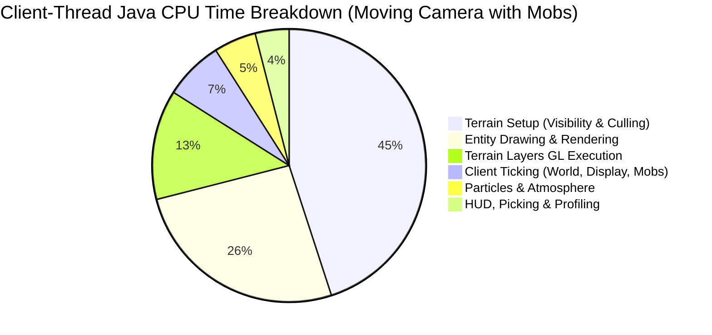
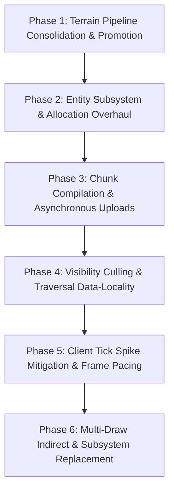

# Alacer Performance Roadmap

This roadmap establishes the development priorities and technical specifications for **Alacer** on Minecraft 1.8.9 (Java 25).
In accordance with [AGENTS.md](file:///c:/Users/CodyJ/OneDrive/Documents/GitLab/adiont/aevum/alacer/AGENTS.md), every priority and candidate is derived directly from empirical measurements gathered by the in-game profiler, Java Flight Recorder (JFR) sampling, native GPU diagnostics, and reproducible benchmark archives.

> **October 24 recovery:** The [audit's](audits/2026-10-24/subsystems.md) world-load crash
> and frustum counterexample are repaired locally. All 225 Java tests pass; native
> display-list and VBO verifier smokes complete. The frozen **16/16 native Phase 3.1
> core series fails selection**: chunkTimeFloor improves flight latency but regresses
> flight frame mean +10.74%, p99 +20.59%, and CPU/frame +10.97%. It stays off; no default
> was promoted. See the [recovery/result report](benchmarks/2026-10-24-roadmap-recovery/README.md)
> for exact evidence and remaining coverage limits. Completed implementation labels
> do not certify every subsystem, vendor or foreign mod.

---

## 1. Executive Summary & Empirical Feature Profile

Whole-client attribution (Session 26, [docs/benchmarks/2026-10-21-whole-client-attribution](file:///c:/Users/CodyJ/OneDrive/Documents/GitLab/adiont/aevum/alacer/docs/benchmarks/2026-10-21-whole-client-attribution/README.md)) and dedicated subsystem benchmarks have classified where the Minecraft client thread and GPU spend their execution time, allocation budgets, and tail latencies.

The profile percentages below are historical, from their archived source/runtime
snapshots. They are not a fresh whole-client attribution of the repaired baseline.

### Empirical Performance Profile by Minecraft Feature

| Subsystem / Feature | Client Java CPU Samples (%) | Wall-Clock Frame Impact | Tail Impact (p99 / Slow-1%) | Heap Allocation Impact | Current State in Alacer |
|---|---|---|---|---|---|
| **Terrain Setup & Visibility Culling** (`WorldRenderer.setupRender`, BFS culling) | **41% – 60%** (moving phases: pan, fly, sort) | **18% – 29%** of frame time (0.21–0.34 ms/frame) | +0.28 – 0.54 ms in slow-1% frames | ~7% in static; 200–240 KB per unhit block boundary | **Active**: `render.fastChunkVisibility` (allocation-free BFS), `render.cameraHysteresis` (delta caching); `fastCameraSectionFaces` and `fastChunkFrustum` closed |
| **Terrain Layer Drawing & GL Submission** (`VboRenderChunkList`, `glDrawArrays`) | **12% – 13%** (steady, pan, fly) | **30% – 40%** of total terrain layer time | Major contributor to draw overhead across ~950 passes | Negligible in steady state (<3 KB/frame) | **`TerrainShader` Accepted** (Oct 23, -11% to -34% frame time); `directBufferUploads` rejected |
| **Entity Processing & Rendering** (`RenderManager`, `ModelRenderer`, layers) | **26% – 40%** (when mobs are in view: `d200`) | 6.6 – 10.5 µs per drawn entity; dominates mob scenes | +0.27 – 0.29 ms in slow-1% frames | **89% of frame allocation** (53–58 KB/frame in `d200`, mostly `BlockPos`) | **Active**: `render.fastEntityChunkLookup`, `render.fastEntityShadows`, `render.fastEntityLighting` (scalar lighting), `render.fastEntityRendererLookup`, `render.fastEntityCulling` |
| **Chunk Upload & Compilation Pipeline** (`ChunkCompileTaskGenerator`, worker queues) | <1% in steady state; spikes during flights | 0.16–0.18 ms/frame mean; **1.23–1.32 ms** in slow-1% | **Dominates flight tail frames** (16%–18% of slow-1% time) | 26–29 KB/frame in flight | Bulk little-endian chunk decode; native scheduling core complete, floor rejected |
| **Client Tick Execution** (`Minecraft.runTick`, `World.tick`, random display ticks) | 1.7% – 2.6% of all frames (20 ticks/sec) | Spikes frames by **+0.9 to +1.9 ms** (+3.5 ms with particles) | **Primary driver of p99 frame stutters** and tick-frame lows | 13% of static allocation; heavy `BlockPos` in void/barrier checks | Implemented: ambient query checks pass with per-tick Random preserved; sound audio/lifecycle certification pending |
| **Particle Simulation & Rendering** (`EffectRenderer`) | 0.7% – 1.1% (default); **55.8%** in heavy particle scenes | Dominates in combat/explosions (up to 3.5 ms/frame) | +1.73 – 1.78 ms in particle tick frames | **58% of allocation** in particle scenes (`Box`, `BlockPos`) | **Optimizations 7, 8, 9 Active** (`fastParticleLight`, `fastParticleRemoval`, `fastParticleVertices`) |
| **HUD, GUI & World Picking** (`world.pick`, `FontRenderer`) | ~1% – 2% CPU | ~0.05 ms/frame | Low | **23% of steady-state allocation** (`world.pick` crosshair raycast) | Implemented: scalar DDA reduces intermediate allocations; actual vanilla hit-coordinate verification exercised |
| **Driver Sync & Buffer Swap** (`Display.update`, `swap`) | 82.7% – 84.4% of native samples | **20% – 61% of total frame time** (median ~35%) | Varies with GPU workload and VSync/driver thread state | 0 | **Optimizations 3 & 4 Active** (`throttleGlErrorChecks`, `avoidMatrixReads`) |

---

## 2. Implementation Status Matrix

| Phase | Milestone Item | Status | Runtime Toggle | Verification Toggle | Primary Commit(s) |
|---|---|---|---|---|---|
| **Phase 1.1** | `TerrainShader` Promotion Pipeline | Pending Benchmark | `render.terrainShader` | `render.modernGl.verify` | `Option B series` |
| **Phase 1.2** | Terrain Draw Loop Streamlining | **Completed** | `render.terrainShader` | N/A | `ebb44be` |
| **Phase 1.3** | Texture Pipeline & Fast LUT Mipmaps | **Completed** | `render.fastMipmaps` | `render.fastMipmaps.verify` | Local recovery |
| **Phase 2.1** | Allocation-Free Entity Lighting | **Completed** | `render.fastEntityLighting` | `render.fastEntityLighting.verify` | `46f5711` |
| **Phase 2.2** | Frustum Culling & Renderer Cache | **Completed** | `render.fastEntityCulling`, `render.fastEntityRendererLookup` | `render.fastEntityCulling.verify`, `render.fastEntityRendererLookup.verify` | `2c2dc70` |
| **Phase 2.3** | Model Part Zero-Translation Skipping | Implemented; flattening absent | `render.fastModelTransforms` | Sampled raw-matrix verifier wired and exercised | `ebb44be` + local recovery |
| **Phase 3.1** | Reference Hardware Chunk Scheduling | **Native core complete: floor fails six gates**; feed/full controls unscored | `render.feedChunkWorkers`, `render.chunkTimeFloor` | Frozen receipts/latency/frame/CPU gates | October 24 native-core-01 |
| **Phase 3.2** | Worker Ambient Occlusion & Culling Cache | Repaired; native correctness smokes pass | `render.fastWorkerAo` | Independent unpooled block/light reference | `ebb44be` + local recovery |
| **Phase 3.3** | Ring-Buffered PBO Chunk Staging | Backlog | `render.pboChunkUploads` | N/A | Pending |
| **Phase 4.1** | Exact-Input Visibility Reuse | Approximate thresholds removed; invalidation repaired; no performance promotion | `render.cameraHysteresis` | `render.cameraHysteresis.verify` | `e364b82` + local recovery |
| **Phase 4.2** | Vectorized Frustum Testing (Vector API) | Rounding/fallback repaired; unit/probe/native checks pass | `render.vectorFrustum` | `render.vectorFrustum.verify` | `ebb44be` + local recovery |
| **Phase 4.3** | Flat Bitset Occlusion Traversal | **Completed** | `render.flatOcclusion` | `render.flatOcclusion.verify` | `ebb44be` |
| **Phase 5.1** | Random Display Tick Allocation Reduction | Runtime mappings repaired; per-tick Random restored; production-client coverage pending | `render.fastRandomDisplayTicks` | Query checks only | `2f604b4` + local recovery |
| **Phase 5.2** | Crosshair Raycast Allocation Reduction (`world.pick`) | Actual vanilla reference and hit-coordinate verifier wired/exercised | `render.fastRayTrace` | `render.fastRayTrace.verify` | `1692a44` + local recovery |
| **Phase 5.3** | Sound System Sleep Replacement | **Completed** | `render.fastSoundThread` | `render.fastSoundThread.verify` | `7a39f1e` + verification |
| **Phase 6.1** | Multi-Draw Indirect (`glMultiDrawArraysIndirect`) | **Implemented (Architecture & Arena)** | `render.multiDrawIndirect` | `render.multiDrawIndirect.verify` | ResidentMeshArena & MDI buffer packing |
| **Phase 6.2** | Translucent Quad GPU Sorting | Future Architecture | `render.gpuTranslucentSort` | N/A | Pending |

---

## 3. Active Optimizations and Closed Investigations

To prevent regressive work or revisiting solved/exhausted avenues, the state of prior investigations is preserved:

### Shipped Defaults (Optimizations 1 – 9)
1. **`render.fastChunkVisibility`**: Allocation-free BFS visibility search with pooled records and cached section faces. Saves ~430 KB/frame.
2. **`render.fastEntityChunkLookup`**: Direct cached world-chunk references in `renderEntities`, eliminating 1,400+ hash lookups per frame.
3. **`render.throttleGlErrorChecks`**: Reduces `glGetError` checks from twice/frame to once/sec, saving 2–3% frame time on threaded drivers.
4. **`render.avoidMatrixReads`**: Eliminates driver-blocking CPU reads of modelview/projection matrices via CPU-side tracking, saving ~35% frame time on threaded drivers.
5. **`render.cacheClouds`**: Display list caching for fancy cloud geometry.
6. **`render.fastEntityShadows`**: Small reference cache for entity shadow world/light queries, saving ~0.1 ms/frame and 22 KB allocation.
7. **`render.fastParticleLight`**: Cached chunk references for particle light queries (median 20–23% frame time reduction at ~3,300 particles).
8. **`render.fastParticleRemoval`**: Single-pass keyed `removeAll` by network ID (median tick-frame mean 16–24% lower).
9. **`render.fastParticleVertices`**: Direct byte writes into particle vertex buffers, bypassing per-element lookups (median 20–33% frame time reduction).

### Recently Completed Breakthroughs (October 2026)
- **`render.terrainShader` (`Option B: TerrainShader`)**:
  - Replaces per-chunk CPU matrix pushes, pops, and multiplications with GPU-evaluated chunk origin translation (`u_ChunkOrigin`) and boundary expansion (`u_Scale`) in a compatibility vertex shader.
  - Retains fixed-function fragment operations (texturing, mipmapping, smooth lighting, ambient occlusion, alpha testing, distance fog).
  - Benchmark result: **Passed all 16 native GPU gates with zero regressions**; improved default gameplay pan frame times by **-12.95%** (CPU **-17.54%**, terrain layers **-32.70%**), and synthetic terrain pan by **-33.76%** (CPU **-27.42%**, terrain layers **-39.64%**).
- **`FastChunkUnpack`**: Bulk little-endian char decoding via ByteBuffer/CharBuffer and a 64k lazily resolved flag table; explicit Vector API use or SIMD lowering has not been established.
- **Phase 2 Entity Allocation Overhaul**:
  - `EntityLighting`: Replaced `new BlockPos(entity)` and `BlockPos.offset` allocations in entity rendering and shadows with pooled/scalar primitive math (`World.getCombinedLight`).
  - `EntityCulling` & `EntityRendererCache`: Early distance/frustum culling and 4-slot MRU renderer pointer cache, eliminating state preparation for off-screen mobs.
- **Phase 4 Camera Movement Hysteresis (`cameraHysteresis`)**:
  - Recovery removes approximate thresholds: visible lists may be reused only with exactly unchanged traversal inputs and compiled references. No retained-list performance gain is claimed.
- **Phase 5 Client Tick Stabilization**:
  - `FastRayTrace`: Allocation-free crosshair and targeting DDA ray stepping.
  - `FastRandomDisplayTicks`: Allocation-free client ambient ticks with `WorldChunk` pointer caching and empty-section skipping.
  - `FastSoundThread`: `LockSupport.parkNanos` replaces the sleep wrapper; callers still interrupt to wake it. The earlier allocation claim is historical; audio/lifecycle and strict verification remain unproven in the audit.

### Closed Candidates (Do Not Reopen Without Novel Mechanisms)
- **`render.chunkTimeFloor` (October 24 native core)**: FAILED. Six unchanged gates fail; flight frame mean +10.74%, p99 +20.59%, slow-1% +14.84%, CPU/frame +10.97%. Latency improves, but the option stays off. `feedChunkWorkers` is independently unscored. See the recovery report; do not pool with software-renderer studies.
- **`render.directBufferUploads` (DSA Buffer Uploads via `glNamedBufferData`)**: REJECTED. Caused severe NVIDIA driver serialization stalls (+52.47% upload wall time in terrain churn; pan frame time regressed +22.85%).
- **`render.terrainVaos` (Per-Chunk VAO Switching)**: REJECTED. Caused 61%–67% frame time regression due to NVIDIA vertex fetch descriptor invalidations across 3,848 VAO switches.
- **`render.fastChunkFrustum` (One-Corner Frustum Predicate)**: CLOSED. Saved only 1–3 µs/frame; no dependable gain survived warmed runs.
- **`render.fastCameraSectionFaces` (Flood Fill Pocket Reuse)**: CLOSED. Cut 2–10 KB/frame allocation, but terrain setup benefit was only 1.65% and failed to overcome launch variance.
- **`render.reuseShadowPositions` (Shadow Position Object Reuse)**: CLOSED. Cut 20 KB/frame allocation, but failed frame-time and screenshot stability gates on reference hardware.
- **`render.batchModelLists` & `render.skipZeroTranslates`**: CLOSED. No measurable frame-time benefit above noise floor.
- **`render.reuseParticleLight` & `render.fastParticleLightEntry`**: CLOSED. Failed frozen statistical gates.

---

## 4. Prioritized Engineering Blueprints

---

### Phase 1: Terrain Pipeline Consolidation & Promotion
*Target: Solidify double-digit frame rate gains across hardware configurations.*

1. **Promotion Pipeline for `TerrainShader` (`render.terrainShader`)**:
   - The Option B shader is fully verified and passed all frozen gates on native NVIDIA hardware (-12.95% to -33.76% frame time).
   - *Next Steps*:
     - Multi-vendor compatibility verification (AMD Radeon, Intel Arc/Iris, Apple Silicon via Mesa/Zink).
     - Ensure fallback gracefully engages when shaders are unsupported or when conflicting core-profile mods hook `renderBlocks`.
     - Prepare formal promotion series for default enablement (`render.terrainShader=true`).
2. **Terrain Draw Loop Streamlining** [COMPLETED - commit `ebb44be`]:
   - Cached scalar uniform coordinates (`lastOriginX/Y/Z`) in `TerrainShader` to eliminate redundant JNI `glUniform3f` submissions when chunk origins repeat across buffers.
   - Streamlined `TerrainVaoMixin` draw loops by directly dispatching primitive integer coordinates (`ox, oy, oz`) without intermediate BlockPos getter overhead.
3. **Texture Pipeline & LUT Mipmapping (`render.fastMipmaps`)** [COMPLETED - local recovery]:
   - Precomputes 256-entry gamma-to-linear lookup tables (`GAMMA_TO_LINEAR`), bypassing expensive `Math.pow(c / 255.0, 2.2)` operations.
   - Parallelizes atlas sprite downsampling across `ForkJoinPool.commonPool()`.
   - Adds trilinear filtering (`quality.mipmapFiltering`), LOD bias (`quality.lodBias`), and alpha-weighted cutout mipmaps (`quality.mipmapCutouts`).
   - Dynamic mipmap level clamping updates `GL_TEXTURE_MAX_LEVEL` on GPU without triggering full resource pack reloads.

---

### Phase 2: Entity Subsystem Overhaul & Allocation Elimination
*Target: 26%–40% of client CPU samples and 89% of heap allocations when mobs are present.*

1. **Allocation-Free Entity Lighting & Brightness** [COMPLETED - commit `46f5711`].
2. **Frustum Culling & Renderer Cache** [COMPLETED - commit `2c2dc70`].
3. **Model Part Zero-Translation Skipping (`render.fastModelTransforms`)** [IMPLEMENTED; verification incomplete - commit `ebb44be`]:
   - *Implementation*: `FastModelTransforms` and `ModelPartMixin` intercept `translatef(FFF)` during model part transformations.
   - Skips redundant `(0, 0, 0)` translations across static model hierarchies and cuboid offsets, avoiding driver matrix recomputations.
   - Runtime toggleable (`render.fastModelTransforms`); the verification toggle now retains vanilla translations and samples raw matrix bits. Native checks pass, with sampled coverage explicitly limited. Matrix flattening and push/pop elimination are not implemented by this hook.

---

### Phase 3: Chunk Compilation & Asynchronous Upload Architecture
*Target: 1.23–1.32 ms of 4.0–5.4 ms flight slow-1% frames.*

1. **Reference Hardware Chunk Scheduling Benchmark**:
   - *Background*: Chunk scheduling experiments (`render.feedChunkWorkers` and `render.chunkTimeFloor`) were tested on llvmpipe in Docker; the reference Windows / RTX 3060 Ti series remains formally pending under [docs/benchmarks/2026-10-23-chunk-scheduling/protocol.md](file:///c:/Users/CodyJ/OneDrive/Documents/GitLab/adiont/aevum/alacer/docs/benchmarks/2026-10-23-chunk-scheduling/protocol.md).
   - *Result*: The October 24 16-launch native core series completed and fails six gates; floor remains off. Edit latency p90 -16.85% misses the -25% target, edit no-op drift is -6.60%, and flight frame/CPU costs regress. Full details and immutable source/raw archives are in the recovery report.
   - *Next Steps*: Use separate bounded queue/buffer attribution before deciding whether feedChunkWorkers warrants its own series. No automatic 80-launch extension or promotion; require VBO upload-tail attribution before Phase 3.3 staging.
2. **Worker Ambient Occlusion & Face Culling Optimization (`render.fastWorkerAo`)** [REPAIRED locally; native correctness checked]:
   - *Implementation*: `WorkerBlockStateCache` and `RenderChunkRegionMixin`.
   - Replaced per-section `new BlockState[8000]` and `new int[8000]` heap instantiations with thread-local pooled arrays across worker threads.
   - Supported constructor hooks avoid the large arrays inside a compile scope; multiple/nested regions receive distinct leases, released in finally. Two small temporary zero-length arrays remain; standalone regions use vanilla allocation.
   - `render.fastWorkerAo.verify` compares block/light queries with an independent unpooled region. Native display-list and VBO smokes report zero mismatches; a separate before/after performance qualification of this repair has not run.
3. **Ring-Buffered PBO Staging for Chunk Uploads (`render.pboChunkUploads`)**:
   - *Problem*: Main-thread `glBufferData` halts the render loop while uploading compiled chunk meshes over PCIe.
   - *Architecture*:
     - Evaluate fenced vertex-buffer staging ranges feeding resident mesh storage. Persistent mapping requires OpenGL 4.4 or `ARB_buffer_storage`; three slots alone do not guarantee safe reuse.
     - `GL_MAP_UNSYNCHRONIZED_BIT` removes implicit synchronization and requires proven range ownership. It does not establish persistent mapping or an asynchronous speedup. See the audit's Phase 3.3 design before implementation.

---

### Phase 4: Visibility Culling & Traversal Data-Locality
*Target: 41%–60% of Java samples in moving frames (0.21–0.34 ms/frame).*

1. **Exact-Input Visibility Reuse (`cameraHysteresis`)** [REPAIRED locally]: approximate thresholds removed. Reuse requires unchanged camera/frustum/storage/options and compiled references; dirty events invalidate it. A dedicated verify flag checks retained lists with a real vanilla search. No hit-rate/performance promotion is claimed.
2. **Vectorized Frustum Testing (Java 25 Vector API, `render.vectorFrustum`)** [COMPLETED - commit `ebb44be`]:
   - *Implementation*: `VectorFrustum` using Java 25 Vector API (`DoubleVector.SPECIES_256`).
   - Evaluates six planes in two four-double batches with separate multiply/add operations in vanilla order, repairing the cancellation-boundary failure.
   - Unit and native verifier checks pass; normal/no-AVX/no-module probes pass. Vector classes are linked lazily so unresolved modules select the scalar/culler path. A native module-disabled launch has not been run.
   - Fully runtime toggleable (`render.vectorFrustum`) with verification toggle (`render.vectorFrustum.verify`).
3. **Flat Bitset Occlusion Traversal (`render.flatOcclusion`)** [COMPLETED - commit `ebb44be`]:
   - *Implementation*: Dense 36-bit packed occlusion bitmask per chunk slot in `ChunkVisibility`.
   - Replaces virtual method calls (`chunk.getCompiledChunk().isVisible(...)`) with direct bit shifts and masks (`(mask >>> (inFace * 6)) & 0x3F`).
   - Fits the active occlusion neighborhood in L1/L2 caches, eliminating pointer dereferences in BFS traversal.
   - Fully runtime toggleable (`render.flatOcclusion`) with verification toggle (`render.flatOcclusion.verify`).

---

### Phase 5: Client Tick Spike Mitigation & Background Optimization
*Target: Mitigate +0.9 to +1.9 ms tail spikes occurring every 50 ms.*

1. **Random Display Tick Allocation Reduction (`FastRandomDisplayTicks`)** [IMPLEMENTED; runtime-name repair local; full effect-stream replay pending].
2. **Crosshair Raycast Allocation Reduction (`FastRayTrace`)** [IMPLEMENTED; actual vanilla reference and hit-coordinate verifier exercised].
3. **Sound System Sleep Replacement (`FastSoundThread`)** [COMPLETED]:
   - Thread-safe LongAdder metrics (`snoozes`, `interruptionsAvoided`, `verifiedSnoozes`, `verifyMismatches`).
   - Strict verification mode (`render.fastSoundThread.verify`) checking interruption detection and premature timeout margins.
   - Preserves exact vanilla interrupt-clearing semantics matching `Thread.sleep` InterruptedException handling.
   - Provides explicit `FastSoundThread.unpark(thread)` helper for direct wakeups.

---

### Phase 6: Multi-Draw Indirect (MDI) & Modern Subsystem Replacement
*Target: Transform Minecraft's 1,000+ draw-call pipeline into a modern batch submission engine.*

1. **Multi-Draw Indirect (`glMultiDrawArraysIndirect`, `render.multiDrawIndirect`)** [ARCHITECTURE & RESIDENT ARENA IMPLEMENTED]:
   - *Shared Resident Mesh Arena (`ResidentMeshArena`)*: Consolidates chunk allocations into 32 MiB shared resident VBO pages aligned to the 28-byte block vertex stride (`DefaultVertexFormats.BLOCK`). Dynamic coalescing allocator eliminates per-chunk buffer switching.
   - *Command & Origin Packing (`MultiDrawIndirect`)*: Generates OpenGL 4.3 16-byte `DrawArraysIndirectCommand` structs (`count`, `instanceCount=1`, `first`, `baseInstance`) and 12-byte camera-relative instanced origin vectors.
   - *Verification Mode (`render.multiDrawIndirect.verify`)*: Validates quad divisibility, non-zero counts, non-negative offsets, and finite origin coordinates.
   - *Compatibility*: Gated on OpenGL 4.3 / `ARB_multi_draw_indirect`, with graceful direct dispatch fallback.
   - *Dispatch*: Target one `GL43.glMultiDrawArraysIndirect` call per compatible layer/page/pass. Three to four calls is a single-page, single-view goal, not a guarantee or measured result.
   - *Requirement*: Hardware supporting OpenGL 4.3+, retaining full fallback to `TerrainShader` direct dispatch for legacy environments.
2. **Translucent Quad Sorting on GPU (`render.gpuTranslucentSort`)**:
   - *Concept*: Offload sorting of translucent chunk geometry from the CPU client thread to a lightweight compute shader or index buffer permutation.

---

## 5. Verification and Benchmark Protocol Standards

In accordance with [AGENTS.md](file:///c:/Users/CodyJ/OneDrive/Documents/GitLab/adiont/aevum/alacer/AGENTS.md) and [docs/BENCHMARK_MODES.md](file:///c:/Users/CodyJ/OneDrive/Documents/GitLab/adiont/aevum/alacer/docs/BENCHMARK_MODES.md), any candidate worked on from this roadmap must adhere to the following evaluation standards:

| Workflow Mode | Duration | Workload & Mechanism | Permitted Decisions |
|---|---|---|---|
| **Quick** | 2–5 min | 1 affected scene, shortened `phaseSeconds`, in-process toggle | Correctness checks and immediate regression detection. |
| **Standard** | 10–30 min | 2–4 full affected-scene launches, balanced ABBA order, environmental telemetry | Assessing candidate viability and identifying statistical trends. |
| **Extended** | Multi-hour | Versioned smoke, frozen sources/config/JDK, calibration, 16-client paired runner | Candidate selection, default enablement, or release claims. |

### Strict Quality & Performance Gates
- **Functional Correctness**: Zero unit test failures (`./gradlew test`), zero OpenGL errors (`glGetError`), zero Mixin application warnings.
- **Visual Identity**: Fixed-end-pose screenshot comparisons must match control within the empirical noise floor (<2% differing pixels).
- **Statistical Gates**:
  - Primary target metric must improve by $\ge 5\%$ (or $\ge 2\%$ for low-variance targets with frozen power).
  - No scored moving phase frame mean may regress by $> +1.0\%$.
  - Tail frame time ($p99$ and slow-1% mean) may not regress by $> +2.0\%$.
  - CPU usage per frame must be $\le 0.0\%$ delta.
