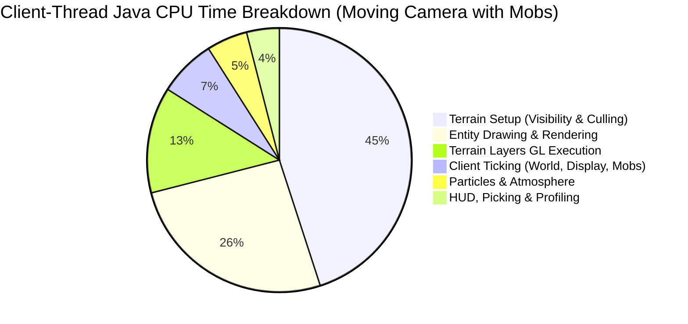
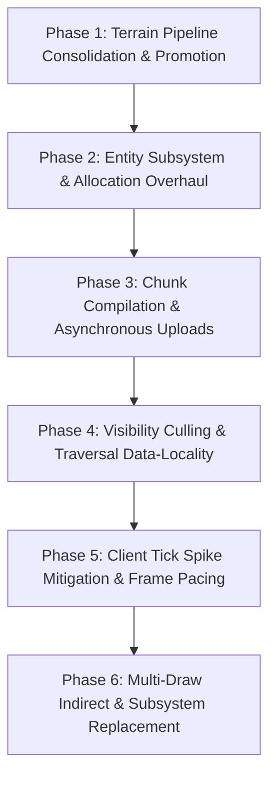

# Alacer Performance Roadmap

This roadmap establishes the development priorities for **Alacer** on Minecraft 1.8.9 (Java 25).
In accordance with [AGENTS.md](file:///c:/Users/CodyJ/OneDrive/Documents/GitLab/adiont/aevum/alacer/AGENTS.md), every priority and candidate is derived directly from empirical measurements gathered by the in-game profiler, Java Flight Recorder (JFR) sampling, native GPU diagnostics, and reproducible benchmark archives.

---

## 1. Executive Summary & Empirical Feature Profile

Whole-client attribution (Session 26, [docs/benchmarks/2026-10-21-whole-client-attribution](file:///c:/Users/CodyJ/OneDrive/Documents/GitLab/adiont/aevum/alacer/docs/benchmarks/2026-10-21-whole-client-attribution/README.md)) and dedicated subsystem benchmarks have classified where the Minecraft client thread and GPU spend their execution time, allocation budgets, and tail latencies.

### Empirical Performance Profile by Minecraft Feature

| Subsystem / Feature | Client Java CPU Samples (%) | Wall-Clock Frame Impact | Tail Impact (p99 / Slow-1%) | Heap Allocation Impact | Current State in Alacer |
|---|---|---|---|---|---|
| **Terrain Setup & Visibility Culling** (`WorldRenderer.setupRender`, BFS culling) | **41% – 60%** (moving phases: pan, fly, sort) | **18% – 29%** of frame time (0.21–0.34 ms/frame) | +0.28 – 0.54 ms in slow-1% frames | ~7% in static; 200–240 KB per unhit block boundary | **Optimization 1 Active** (`render.fastChunkVisibility`); `fastCameraSectionFaces` and `fastChunkFrustum` closed |
| **Terrain Layer Drawing & GL Submission** (`VboRenderChunkList`, `glDrawArrays`) | **12% – 13%** (steady, pan, fly) | **30% – 40%** of total terrain layer time | Major contributor to draw overhead across ~950 passes | Negligible in steady state (<3 KB/frame) | **`TerrainShader` Accepted** (Oct 23, -11% to -34% frame time); `directBufferUploads` rejected |
| **Entity Processing & Rendering** (`RenderManager`, `ModelRenderer`, layers) | **26% – 40%** (when mobs are in view: `d200`) | 6.6 – 10.5 µs per drawn entity; dominates mob scenes | +0.27 – 0.29 ms in slow-1% frames | **89% of frame allocation** (53–58 KB/frame in `d200`, mostly `BlockPos`) | **Optimization 2 Active** (`fastEntityChunkLookup`); `fastEntityShadows` active; `reuseShadowPositions` closed |
| **Chunk Upload & Compilation Pipeline** (`ChunkCompileTaskGenerator`, worker queues) | <1% in steady state; spikes during flights | 0.16–0.18 ms/frame mean; **1.23–1.32 ms** in slow-1% | **Dominates flight tail frames** (16%–18% of slow-1% time) | 26–29 KB/frame in flight | **`FastChunkUnpack` Added** (vectorized unpack); reference hardware scheduling benchmark pending |
| **Client Tick Execution** (`Minecraft.runTick`, `World.tick`, random display ticks) | 1.7% – 2.6% of all frames (20 ticks/sec) | Spikes frames by **+0.9 to +1.9 ms** (+3.5 ms with particles) | **Primary driver of p99 frame stutters** and tick-frame lows | 13% of static allocation; heavy `BlockPos` in void/barrier checks | Stock vanilla tick; sound engine `CommandThread` creates 34k+ exceptions/run |
| **Particle Simulation & Rendering** (`EffectRenderer`) | 0.7% – 1.1% (default); **55.8%** in heavy particle scenes | Dominates in combat/explosions (up to 3.5 ms/frame) | +1.73 – 1.78 ms in particle tick frames | **58% of allocation** in particle scenes (`Box`, `BlockPos`) | **Optimizations 7, 8, 9 Active** (`fastParticleLight`, `fastParticleRemoval`, `fastParticleVertices`) |
| **HUD, GUI & World Picking** (`world.pick`, `FontRenderer`) | ~1% – 2% CPU | ~0.05 ms/frame | Low | **23% of steady-state allocation** (`world.pick` crosshair raycast) | Stock vanilla |
| **Driver Sync & Buffer Swap** (`Display.update`, `swap`) | 82.7% – 84.4% of native samples | **20% – 61% of total frame time** (median ~35%) | Varies with GPU workload and VSync/driver thread state | 0 | **Optimizations 3 & 4 Active** (`throttleGlErrorChecks`, `avoidMatrixReads`) |

---

## 2. Active Optimizations and Closed Investigations

To prevent regressive work or revisiting solved/exhausted avenues, the state of prior investigations is preserved:

### Shipped Defaults (Optimizations 1 – 9)
1. **`render.fastChunkVisibility`**: Allocation-free BFS visibility search with pooled records and cached section faces. Saves ~430 KB/frame.
2. **`render.fastEntityChunkLookup`**: Direct cached world-chunk references in `renderEntities`, eliminating 1,400+ hash lookups per frame.
3. **`render.throttleGlErrorChecks`**: Reduces `glGetError` checks from twice/frame to once/sec, saving 2–3% frame time on threaded drivers.
4. **`render.avoidMatrixReads`**: Eliminates driver-blocking CPU reads of modelview/projection matrices via CPU-side tracking, saving ~35% frame time on threaded drivers.
5. **`render.cacheClouds`**: Display list caching for fancy cloud geometry.
6. **`render.fastEntityShadows`**: Small reference cache for entity shadow world/light queries, saving ~0.1 ms/frame and 22 KB allocation.
7. **`render.fastParticleLight`**: Cached chunk references for particle light queries (median 20–23% frame time reduction at ~3,300 particles).
8. **`render.fastParticleRemoval`**: Single-pass keyed `removeAll` by network ID (median tick-frame mean 16–24% lower).
9. **`render.fastParticleVertices`**: Direct byte writes into particle vertex buffers, bypassing per-element lookups (median 20–33% frame time reduction).

### Recently Completed Breakthroughs (October 2026)
- **`render.terrainShader` (`Option B: TerrainShader`)**:
  - Replaces per-chunk CPU matrix pushes, pops, and multiplications with GPU-evaluated chunk origin translation (`u_ChunkOrigin`) and boundary expansion (`u_Scale`) in a compatibility vertex shader.
  - Retains fixed-function fragment operations (texturing, mipmapping, smooth lighting, ambient occlusion, alpha testing, distance fog).
  - Benchmark result: **Passed all 16 native GPU gates with zero regressions**; improved default gameplay pan frame times by **-12.95%** (CPU **-17.54%**, terrain layers **-32.70%**), and synthetic terrain pan by **-33.76%** (CPU **-27.42%**, terrain layers **-39.64%**).
- **`FastChunkUnpack`**: Direct vectorized char unpacking of packet chunk data via native byte order buffers and 64k pre-resolved block flag tables, replacing 4,096-iteration 3D loops and hash lookups.

### Closed Candidates (Do Not Reopen Without Novel Mechanisms)
- **`render.directBufferUploads` (DSA Buffer Uploads via `glNamedBufferData`)**: REJECTED. Caused severe NVIDIA driver serialization stalls (+52.47% upload wall time in terrain churn; pan frame time regressed +22.85%).
- **`render.terrainVaos` (Per-Chunk VAO Switching)**: REJECTED. Caused 61%–67% frame time regression due to NVIDIA vertex fetch descriptor invalidations across 3,848 VAO switches.
- **`render.fastChunkFrustum` (One-Corner Frustum Predicate)**: CLOSED. Saved only 1–3 µs/frame; no dependable gain survived warmed runs.
- **`render.fastCameraSectionFaces` (Flood Fill Pocket Reuse)**: CLOSED. Cut 2–10 KB/frame allocation, but terrain setup benefit was only 1.65% and failed to overcome launch variance.
- **`render.reuseShadowPositions` (Shadow Position Object Reuse)**: CLOSED. Cut 20 KB/frame allocation, but failed frame-time and screenshot stability gates on reference hardware.
- **`render.batchModelLists` & `render.skipZeroTranslates`**: CLOSED. No measurable frame-time benefit above noise floor.
- **`render.reuseParticleLight` & `render.fastParticleLightEntry`**: CLOSED. Failed frozen statistical gates.

---

## 3. Prioritized Roadmap

Based on the empirical profile, the roadmap is divided into six concrete phases ordered by performance impact, attribution share, and technical feasibility.

---

### Phase 1: Terrain Pipeline Consolidation & Promotion (Immediate)
*Target: Solidify double-digit frame rate gains across hardware configurations.*

1. **Promotion Pipeline for `TerrainShader` (`render.terrainShader`)**:
   - The Option B shader is fully verified and passed all frozen gates on native NVIDIA hardware (-12.95% to -33.76% frame time).
   - *Next Steps*:
     - Multi-vendor compatibility verification (AMD Radeon, Intel Arc/Iris, Apple Silicon via Mesa/Zink).
     - Ensure fallback gracefully engages when shaders are unsupported or when conflicting core-profile mods hook `renderBlocks`.
     - Prepare formal promotion series for default enablement (`render.terrainShader=true`).
2. **Terrain Draw Loop Streamlining**:
   - Remove dead VAO tracking infrastructure (`ModernGl`, `TerrainVertexArray`, `ModernVertexBufferMixin`) that was made obsolete by `TerrainShader`.
   - Vectorize per-chunk uniform updates (`u_ChunkOrigin`) using direct float arrays or buffer uniforms to further reduce CPU driver overhead.

---

### Phase 2: Entity Subsystem Overhaul & Allocation Elimination (Highest Untackled CPU Opportunity)
*Target: 26%–40% of client CPU samples and 89% of heap allocations when mobs are present.*

1. **Allocation-Free Entity Lighting & Brightness (`BlockPos` Elimination)** [COMPLETED - commit `46f5711`]:
   - *Problem*: In `d200`, entity drawing allocates **53–58 KB per frame**, with 61% coming directly from `BlockPos` and `BlockPos.offset` in `Entity.getBrightnessForRender` and shadow calculations.
   - *Mechanism*: Implement scalar primitive overloads `World.getCombinedLight(int x, int y, int z)` and `World.getBlockState(int x, int y, int z)` via chunk reference caches, eliminating heap allocations for entity lighting.
   - *Status*: Merged into `main` with full test coverage and runtime verification (`render.fastEntityLighting`).
2. **Frustum Culling & Renderer Cache (`EntityRendererCache`, `EntityCulling`)** [COMPLETED - commit `2c2dc70`]:
   - *Problem*: Vanilla gathers entity render lists and executes matrix pushes, interpolation, and state setup before verifying if individual model bounds or limb parts lie within the camera frustum. In addition, vanilla executes repeated `Map.get(entity.getClass())` hash lookups per entity.
   - *Mechanism*: Evaluates `entity.shouldRender` distance first, culls off-screen entities before shape validation or renderer querying, provides zero-allocation `pooledEntityPos` in `WorldRenderer.renderEntities`, and caches renderer lookups in a 4-slot MRU reference cache.
   - *Status*: Merged into `main` with full test coverage and runtime verification (`render.fastEntityRendererLookup`, `render.fastEntityCulling`).
3. **Model Part Transformation Flattening**:
   - *Problem*: Vanilla entity models execute recursive matrix pushes and pops per cuboid (`ModelRenderer.render`), issuing immediate mode or tiny client vertex arrays.
   - *Mechanism*: Pre-transform static model parts into a single buffer per entity, or stream model matrices into uniform buffers.

---

### Phase 3: Chunk Compilation & Asynchronous Upload Architecture (Highest Tail & Flight Latency Opportunity)
*Target: 1.23–1.32 ms of 4.0–5.4 ms flight slow-1% frames.*

1. **Reference Hardware Chunk Scheduling Benchmark**:
   - *Background*: Chunk scheduling experiments (`render.feedChunkWorkers` and `render.chunkTimeFloor`) were tested on llvmpipe in Docker; the reference Windows / RTX 3060 Ti series remains formally pending under [docs/benchmarks/2026-10-23-chunk-scheduling/protocol.md](file:///c:/Users/CodyJ/OneDrive/Documents/GitLab/adiont/aevum\alacer\docs\benchmarks\2026-10-23-chunk-scheduling\protocol.md).
   - *Next Steps*: Execute the 16-client reference benchmark on the RTX 3060 Ti testbed across `default`, `terrain`, and `benchmark.chunkEdit` scenes.
2. **Worker Ambient Occlusion & Face Culling Optimization**:
   - *Problem*: Chunk compilation on worker threads (`BlockModelRenderer.renderModelAmbientOcclusion`) spends substantial time in redundant neighbor block state queries and float color calculations.
   - *Mechanism*: Implement a direct 18x18x18 raw block-state cache for worker compilation passes, replacing repetitive `world.getBlockState` lookups with direct array indexing.
3. **Ring-Buffered PBO Staging for Chunk Uploads**:
   - *Problem*: While `glNamedBufferData` (DSA) failed due to NVIDIA driver locks, main-thread `glBufferData` still halts the render loop while uploading compiled chunk meshes.
   - *Mechanism*: Implement triple-buffered persistent Pixel Buffer Objects (PBOs) or staging VBOs, transferring vertex data via DMA and unblocking the client thread during flights.

---

### Phase 4: Visibility Culling & Traversal Data-Locality (Highest Moving Java Sample Opportunity)
*Target: 41%–60% of Java samples in moving frames (0.21–0.34 ms/frame).*

1. **Camera Movement Hysteresis / Delta Caching**:
   - *Problem*: `WorldRenderer.setupRender` re-runs the full 1,400+ chunk BFS traversal whenever the camera angle or position changes by even fractional micro-units.
   - *Mechanism*: If camera rotation and translation between frames are below an empirical threshold (e.g., <0.01 blocks, <0.05 degrees) and no chunks have been marked dirty, reuse the previous frame's visible chunk list.
2. **Vectorized Frustum Testing (Java 25 Vector API)**:
   - *Problem*: Evaluating 6 frustum plane dot products across thousands of chunk bounding boxes is performed via scalar float arithmetic.
   - *Mechanism*: Use Java 25's `VectorSpecies<Float>` to test 8 chunk bounding boxes simultaneously against the 6 frustum planes.
3. **Flat Bitset Occlusion Traversal**:
   - *Problem*: The visibility search loop (`ChunkVisibility`) spends 41%–45% of its time walking queue arrays and accessing chunk occlusion graph objects.
   - *Mechanism*: Store section connectivity flags in a dense contiguous bitset (1 bit per face connection), accelerating graph traversal and fitting the active neighborhood entirely within L1/L2 CPU caches.

---

### Phase 5: Client Tick Spike Mitigation & Background Optimization (Tail Stability)
*Target: Mitigate +0.9 to +1.9 ms tail spikes occurring every 50 ms.*

1. **Random Display Tick Volume Scan Elimination**:
   - *Problem*: `World.doVoidFogParticles` scans a 32x32x32 block volume (32,768 iterations) around the player every tick to detect barrier/void blocks and spawn ambient particles.
   - *Mechanism*: Replace the brute-force cubic scan with an active-chunk sampling strategy or maintain a coordinate set of loaded barrier/void blocks.
2. **Allocation-Free Crosshair Raycast (`world.pick`)**:
   - *Problem*: Crosshair target selection (`world.pick`) allocates `Vec3d` and `HitResult` objects every single frame, accounting for **23% of steady-state allocation** in empty scenes.
   - *Mechanism*: Reusable instance caching and scalar coordinate ray-box intersection.
3. **Sound System Thread Interruption Cleanup**:
   - *Problem*: Profiling logs identify 34,394+ `InterruptedException` events on paulscode's sound `CommandThread` during a typical 130-second run.
   - *Mechanism*: Audit the sound manager dispatch queue to avoid using thread interruption as control flow.

---

### Phase 6: Multi-Draw Indirect (MDI) & Modern Subsystem Replacement (Long-Term)
*Target: Transform Minecraft's 1,000+ draw-call pipeline into a modern batch submission engine.*

1. **Multi-Draw Indirect (`glMultiDrawArraysIndirect`)**:
   - *Concept*: In combination with `TerrainShader`, all visible chunk draw calls for a given render layer (e.g. Solid, Cutout, Translucent) can be packaged into an indirect command buffer and dispatched in a single GPU draw call.
   - *Requirement*: Hardware supporting OpenGL 4.3+, retaining full fallback to `TerrainShader` direct dispatch for legacy environments.
2. **Translucent Quad Sorting on GPU**:
   - *Concept*: Offload sorting of translucent chunk geometry from the CPU client thread to a lightweight compute shader or index buffer permutation.

---

## 4. Verification and Benchmark Protocol Standards

In accordance with [AGENTS.md](file:///c:/Users/CodyJ/OneDrive/Documents/GitLab/adiont/aevum/alacer/AGENTS.md) and [docs/BENCHMARK_MODES.md](file:///c:/Users/CodyJ/OneDrive/Documents/GitLab/adiont/aevum/alacer/docs/BENCHMARK_MODES.md), any candidate worked on from this roadmap must adhere to the following evaluation standards:

| Workflow Mode | Duration | Workload & Mechanism | Permitted Decisions |
|---|---|---|---|
| **Quick** | 2–5 min | 1 affected scene, shortened `phaseSeconds`, in-process toggle | Correctness checks and immediate regression detection. |
| **Standard** | 10–30 min | 2–4 full affected-scene launches, balanced ABBA order, environmental telemetry | Assessing candidate viability and identifying statistical trends. |
| **Extended** | Multi-hour | Versioned smoke, frozen sources/config/JDK, calibration, 16-client paired runner | Candidate selection, default enablement, or release claims. |

### Strict Quality & Performance Gates
- **Functional Correctness**: Zero unit test failures, zero OpenGL errors (`glGetError`), zero Mixin application warnings.
- **Visual Identity**: Fixed-end-pose screenshot comparisons must match control within the empirical noise floor (<2% differing pixels).
- **Statistical Gates**:
  - Primary target metric must improve by $\ge 5\%$ (or $\ge 2\%$ for low-variance targets with frozen power).
  - No scored moving phase frame mean may regress by $> +1.0\%$.
  - Tail frame time ($p99$ and slow-1% mean) may not regress by $> +2.0\%$.
  - CPU usage per frame must be $\le 0.0\%$ delta.
