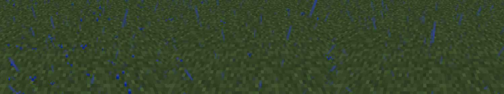
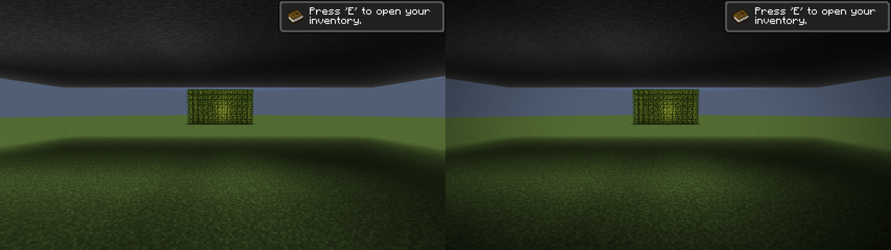
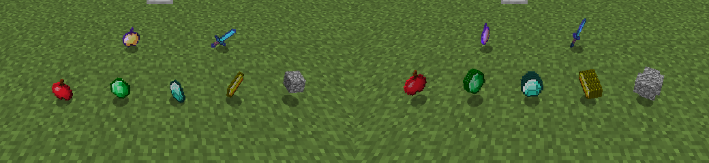
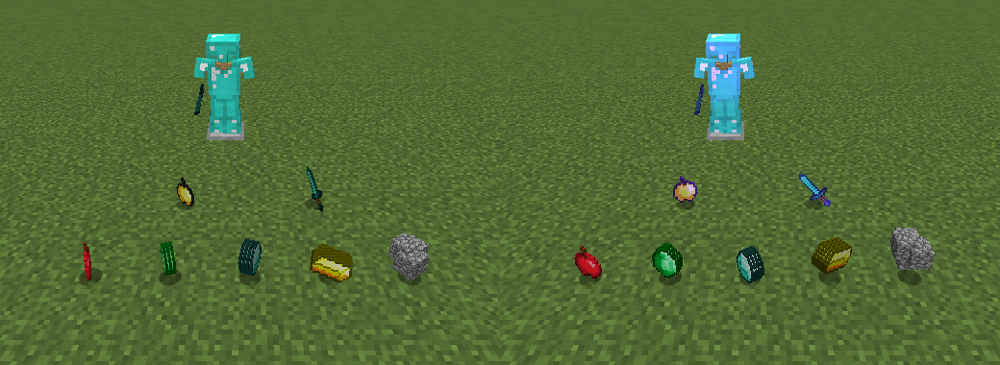
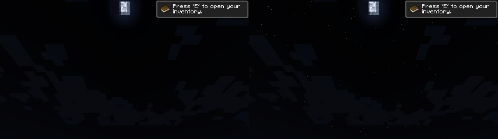
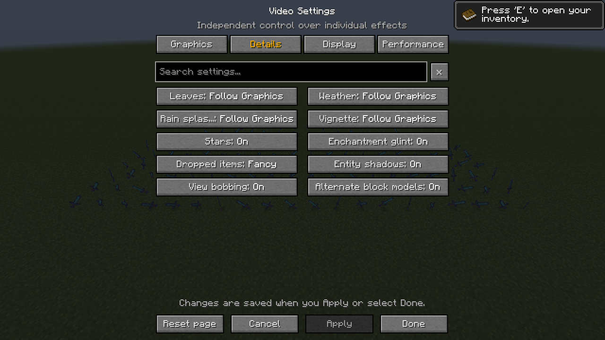
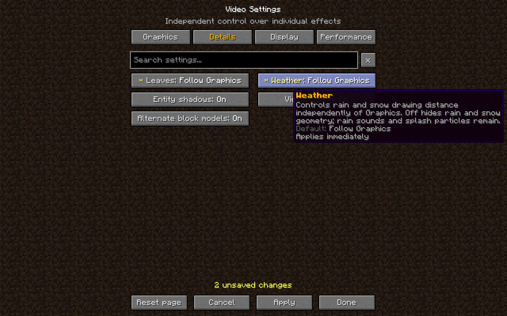

# Video settings

Open **Options -> Video Settings**. The menu uses Minecraft 1.8.9's own button
textures, slider handles, bordered text field, tooltip renderer and background.
The centered, two-column layout follows the game's existing options screens.
Resource packs continue to supply the standard widget textures.

Graphics, Details, Display and Performance organize the controls. Search matches
names and descriptions across every category. Hover a setting for its full name,
description, default and application requirements. Long button names shorten to
fit; their values remain visible.

Gold identifies the selected category and help headings. Descriptions use gray;
pending edits have a yellow `*` and a yellow count. A saved confirmation is green,
a restart notice is gold, and a save failure is red. Text and markers accompany
these colors, so color alone never carries the setting state.

## Editing and saving

- Left-click a choice to advance it; right-click to go back. Drag a slider to
  adjust it. The mouse wheel, scrollbar and Page Up/Down navigate longer results.
- Edits are staged. **Apply** saves them; **Done** saves and returns to Options.
- **Cancel** or Escape asks before discarding pending edits. Already applied
  values remain saved. Escape closes a confirmation before leaving the menu.
- **Reset page** asks for confirmation and stages that category's defaults.
  Apply is still required. Reset is disabled during a global search.
- Tab/Shift+Tab move button focus; arrows adjust a focused setting; Enter/Space
  activate it. Ctrl+F focuses search. These keyboard paths are implemented; the
  full keyboard-only interaction matrix remains a live validation gap.

Vanilla options keep Minecraft's existing application/reload methods and save to
`options.txt`. Explicit Alacer edits merge into `config/alacer.properties` without
saving unrelated live overrides. The Alacer file is replaced atomically where
the filesystem supports it. Vanilla's own save method still owns its file; this
is not a transaction spanning both files. Unknown Alacer property values survive
a menu save, but original comments and formatting are regenerated.

Benchmark launches are read-only. JVM-controlled Alacer settings are locked with
an explanation. Unsupported VBO controls are also locked. Experimental render
paths, intrusive profilers and verification switches are deliberately absent.
The nine shipped optimization defaults and the user's saved vanilla backend are
unchanged. Particle vertex writing is selected at startup: its saved preference
appears immediately in the menu, while the active hooks change after restart.
Reverting that preference to the currently active value clears the restart notice.

## Atmosphere controls

The Graphics page now also includes the following controls. All default to the
existing appearance; edits are staged until Apply. The wider two-column menu
retains Minecraft's native button textures, slider handles, pixel font and
resource-pack widgets, with a selected-tab underline and a visible settings count.

| Setting | Range | Default | Effect |
|---|---|---|---|
| Fog start | 0–95% of render distance | 75% | Move ordinary terrain fog closer for a softer horizon, or farther for a clearer view. Water, lava, blindness, sky fog and dimension-specific thick fog keep their existing behavior. |
| Cloud height | −64 to +128 blocks relative to the dimension's cloud layer | Default / 0 | Move Fast, Fancy and cached clouds together. The cache continues to rebuild only when its geometry/color inputs require it. |
| Sky | Off / On | On | Hide or show the complete sky pass: sky dome, sun, moon, stars and the End sky. Clouds remain a separate control. |
| Star brightness | 0–200% | 100% | Adjust existing night-sky stars. Requires Sky and Stars enabled; does not create daytime stars or change world lighting. |
| Weather opacity | 0–100% | 100% | Soften rain and snow geometry independently of rain sounds, splash particles and server weather. Requires Weather enabled. |

The persisted keys are `quality.fogStart`, `quality.cloudHeight`, `quality.sky`,
`quality.starBrightness` and `quality.weatherOpacity`. Each is exported with the
effective phase configuration. Benchmark launches retain build defaults and
remain read-only. The sky switch skips the entire draw call, preserving the
pairing of existing sky profiler hooks. No optimization default changes.

## Independent quality controls

Minecraft 1.8.9 reads its single Graphics option (`GameOptions.fancyGraphics`)
in five places outside its own load/save/menu code. Each read that changes what
is drawn now has its own Details control; Graphics remains the base for every
control set to **Follow Graphics**:

| Graphics read | Setting | Choices | Application |
|---|---|---|---|
| `WorldRenderer.reload` (2) | Leaves | Follow Graphics, Fast, Fancy | Rebuilds terrain using Minecraft's existing leaf modes. |
| `GameRenderer.renderSnowAndRain` | Weather | Follow Graphics, Fast, Fancy, Off | Changes rain/snow geometry and drawing distance. |
| `GameRenderer.tickRain` | Rain splashes | Follow Graphics, Fast, Fancy, Off | Fast halves the rain strength used to spawn splashes (about a quarter as many particles). Off spawns none. Immediate. |
| `GameGui.render` (`Minecraft.isFancyGraphicsEnabled`) | Vignette | Follow Graphics, Off, On | Off skips the full-screen vignette overlay, including its red world-border warning tint, exactly as Fast Graphics does. Immediate. |
| `Minecraft.runGame` | none | | Only the F3 debug text (" fast"); not a rendering decision. |

Weather Off hides precipitation geometry; server weather, sounds and splash
particles remain (use Rain splashes for those particles). Rain splashes Off
still samples splash positions, so rain sounds keep vanilla's behaviour. The
Particles setting continues to scale or disable splashes as before.

Additional Details controls are independent of Graphics and default to vanilla:

| Setting | Choices | Default | Application |
|---|---|---|---|
| Stars | Off, On | On | Off reports zero star brightness to the sky pass, which skips the star list. Sky colour, sun, moon and clouds are unchanged. Immediate. |
| Enchantment glint | Off, On | On | Off skips the glint pass on enchanted items, potions and other glinting items (world, hand, inventory) and on worn enchanted armor. Immediate. |
| Dropped items | Fast, Fancy | Fancy | Fast draws one model per dropped stack instead of up to five, chosen by stack size. Immediate. |

These controls expose existing rendering modes, or skip an existing optional
pass. They do not introduce a new renderer. Saved values are `quality.*`
options in `config/alacer.properties`; every value is included in profile and
benchmark exports (each phase's `config`), and benchmark launches use the
defaults above.

## Validation, 2026-10-22: split Graphics and new Details controls

Evidence is in [validation/2026-10-22-video-settings](validation/2026-10-22-video-settings/).
This was a Linux cloud container, not the reference Windows machine:
Temurin 25.0.5+8, Xvfb at 1280x720, Mesa llvmpipe software OpenGL 4.5, 4 CPU
threads. No GPU, so the timings below are not comparable to the benchmark archives.

**Build and unit tests.** `clean build --offline` with `JAVA_HOME` set to that JDK:
110 tests, no failures/errors/skips; 175 main classes at classfile version 69.
New tests cover menu/config default agreement, persistence and live update,
invalid values, clamping, launch-override locking, benchmark defaults, labels,
effects and search.

**Real client.** A temporary harness ([VisualCheck.java](validation/2026-10-22-video-settings/VisualCheck.java),
not shipped) created a fresh superflat spectator world. It changed each setting
through `VideoSettingsBackend.apply`, the menu's Apply path, and took screenshots
in place. Four launches: `full`, `readback`, `rerun`, `vignette`. A final smoke
launch of the shipping build (harness removed) reached the title screen without
mixin or injection errors.

| Setting | Observed |
|---|---|
| Rain splashes | Mean live particles in rain over 200 frames: Fancy 653.5, Fast 163.7, Off 0.0, Follow Graphics 654.7 (Graphics Fancy) and 163.4 (Graphics Fast). |
| Vignette | Under a 31x31 roof: corner mean 0.159 Off, 0.087 On, 0.087 Follow Graphics (Fancy), 0.151 Follow Graphics (Fast); centre unchanged. At noon or night outdoors vanilla's vignette is effectively invisible (the client world keeps full sky light), so the overlay costs frame time there without visibly changing the image. |
| Stars | Midnight sky: stars absent with Off; moon, clouds and sky colour unchanged. |
| Enchantment glint | Off removes glint from a dropped enchanted sword and golden apple and from an armor stand's enchanted armor; On restores it. |
| Dropped items | Fast draws one model per stack; Fancy draws the vanilla copies (up to five). A single apple looks the same in both. |
| Persistence | Non-default values saved in one launch were read back by a fresh JVM (startup log and menu), then restored to defaults through Apply. |

**Indicative frame time.** Alternating A/B blocks (ABBA order), 4 blocks of 300
frames per choice after a settle period, FPS uncapped, VSync off, render distance 8.
This is one session on software rendering, not a benchmark series. Leaves (an
existing control) is included for scale.

| Comparison | Scene | Mean frame time | Change | Blocks agreeing |
|---|---|---|---|---|
| Rain splashes Fancy -> Off | rain, ~650 splash particles | 69.39 -> 64.93 ms | -4.46 ms (-6.4%) | 4/4 |
| Vignette On -> Off | open field, day | 39.97 -> 36.14 ms | -3.83 ms (-9.6%) | 4/4 |
| Dropped items Fancy -> Fast | 300 dropped full stacks | 51.13 -> 42.23 ms | -8.89 ms (-17.4%) | 4/4 |
| Enchantment glint On -> Off | 300 dropped enchanted swords | 50.92 -> 45.13 ms | -5.79 ms (-11.4%) | 4/4 |
| Leaves Fancy -> Fast | 13x7x2 leaf wall | 46.46 -> 43.17 ms | -3.29 ms (-7.1%) | 4/4 |

Stars were not timed: they are a single display list. The first run's dropped-item
and glint blocks are excluded. 1.8.9's `ItemEntity.setNeverDespawn()` only delays
despawning by five minutes, so the grids vanished mid-measurement; this shows
in `results-full.txt`. The rerun pinned item age to vanilla's never-despawn value.
Entity counts were identical before and after each series.

Not checked: snow, rain-splash smoke over lava, the world-border warning tint,
potion glint in a held item, resource packs, other GUI scales, other drivers and
the reference hardware. On a GPU, the full-screen vignette and fill-heavy passes
may cost proportionally less or more than under llvmpipe.

## Validation, 2026-10-21

`JAVA_HOME=C:/Program Files/Eclipse Adoptium/jdk-25.0.4.101-hotspot` was explicit
for builds, tests and the game. `test build --offline --console=plain` passed:
98 tests, no failures/errors/skips; 165 main classes at classfile version 69.
The actual game executable and command line were checked: the specified JDK's
`bin/java.exe`, Java 25.0.4.1, `--enable-native-access=ALL-UNNAMED`,
`-XX:StackShadowPages=32`, and `-Xmx2G`, with Mixin diagnostics for these checks.

Six serial UI attempts were retained with unique logs at
`build/settings-ui-live-r1.log` through `r6.log`. Attempts 1 and 2 failed because
the leaf reload selector did not resolve; the final `reload()V` descriptor fixed
the injection. Attempts 3 and 4 exercised the initial menu and in-world apply;
5 checked the vanilla-widget redesign; 6 checked the formatting-code theme.
Builds happened before launches, and sources were not edited while clients ran.

Live checks used `build/settings-ui-client`, with a dedicated copy of the
benchmark base world for the in-world smoke test. These were interactive checks,
not measured flights. The normal user's paused client was saved and closed with
permission before serial testing. Its settings/world were not used for UI edits.

Observed live: opening from title and in-world Options; global search; staged
values staying off disk until Apply; Keep Editing retaining pending changes;
scoped reset staging defaults; persistence across relaunch; GUI scale application;
leaf/weather application with an active world and terrain reload; yellow pending,
gold restart and green saved messages; restart preference reversion clearing the
notice. No selected application, injection or GL error was reported in successful
attempts. The legacy Realms missing-class startup warning remains separate.

The final color check saved particle vertex writing Off and then restored On,
and restored both quality overrides to Follow Graphics in the isolated config.
Unit tests separately cover retained live startup state, next-load preference,
save failures, malformed files, JVM override precedence, benchmark read-only
behavior, reset scoping, global search and independent quality selection.

Remaining checks include rainy/snowy-biome visual comparisons, leaf appearance
across resource packs/backends, fullscreen and monitor changes, every GUI scale,
complete keyboard-only operation, live read-only/save-failure UI, other mods and
non-English localization. There is no new frame-time or pixel-equivalence claim.
Frozen benchmark archives, prior runners and Java 8 evidence remain unchanged.

Hashes, attempt outcomes and preservation checks are in
[validation.json](validation/2026-10-21-video-settings/validation.json).
