# Video settings

Open **Options -> Video Settings**. The menu uses Minecraft 1.8.9's own button
textures, slider handles, bordered text field, tooltip renderer and background.
The centered, two-column layout follows the game's existing options screens.
Resource packs continue to supply the standard widget textures.

Graphics, Details, Display, Performance and Advanced organize 58 controls, and
**Presets...** stages a group of appearance choices. Search matches names and
descriptions across every category. Hover a setting for its full name,
description, default and application requirements. Long button names shorten to
fit; their values remain visible.

Gold identifies the selected category and help headings. Descriptions use gray;
pending edits have a yellow `*` and a yellow count. A saved confirmation is green,
a restart notice is gold, and a save failure is red. Text and markers accompany
these colors, so color alone never carries the setting state.

## Editing and saving

- Left-click a choice to advance it; right-click to go back. Drag a slider to
  adjust it. The mouse wheel, scrollbar and Page Up/Down navigate longer results.
- Edits are staged. **Apply** saves them; **Done** saves and returns to Options.
- **Cancel** or Escape asks before discarding pending edits. Already applied
  values remain saved. Escape closes a confirmation before leaving the menu.
- **Reset page** asks for confirmation and stages that category's defaults.
  Apply is still required. Reset is disabled during a global search.
- Tab/Shift+Tab move button focus; arrows adjust a focused setting; Enter/Space
  activate it. Ctrl+F focuses search. These keyboard paths are implemented; the
  full keyboard-only interaction matrix remains a live validation gap.

Vanilla options keep Minecraft's existing application/reload methods and save to
`options.txt`. Explicit Alacer edits merge into `config/alacer.properties` without
saving unrelated live overrides. The Alacer file is replaced atomically where
the filesystem supports it. Vanilla's own save method still owns its file; this
is not a transaction spanning both files. Unknown Alacer property values survive
a menu save, but original comments and formatting are regenerated.

Benchmark launches are read-only. JVM-controlled Alacer settings are locked with
an explanation. Unsupported VBO controls are also locked. Experimental render
paths, intrusive profilers and verification switches are deliberately absent.
The nine shipped optimization defaults and the user's saved vanilla backend are
unchanged. Particle vertex writing is selected at startup: its saved preference
appears immediately in the menu, while the active hooks change after restart.
Reverting that preference to the currently active value clears the restart notice.

## Atmosphere controls

The Graphics page now also includes the following controls. All default to the
existing appearance; edits are staged until Apply. The wider two-column menu
retains Minecraft's native button textures, slider handles, pixel font and
resource-pack widgets, with a selected-tab underline and a visible settings count.

| Setting | Range | Default | Effect |
|---|---|---|---|
| Fog start | 0–95% of render distance | 75% | Move ordinary terrain fog closer for a softer horizon, or farther for a clearer view. Water, lava, blindness, sky fog and dimension-specific thick fog keep their existing behavior. |
| Cloud height | −64 to +128 blocks relative to the dimension's cloud layer | Default / 0 | Move Fast, Fancy and cached clouds together. The cache continues to rebuild only when its geometry/color inputs require it. |
| Sky | Off / On | On | Hide or show the complete sky pass: sky dome, sun, moon, stars and the End sky. Clouds remain a separate control. |
| Star brightness | 0–200% | 100% | Adjust existing night-sky stars. Requires Sky and Stars enabled; does not create daytime stars or change world lighting. |
| Weather opacity | 0–100% | 100% | Soften rain and snow geometry independently of rain sounds, splash particles and server weather. Requires Weather enabled. |

The persisted keys are `quality.fogStart`, `quality.cloudHeight`, `quality.sky`,
`quality.starBrightness` and `quality.weatherOpacity`. Each is exported with the
effective phase configuration. Benchmark launches retain build defaults and
remain read-only. The sky switch skips the entire draw call, preserving the
pairing of existing sky profiler hooks. No optimization default changes.

## Independent quality controls

Minecraft 1.8.9 reads its single Graphics option (`GameOptions.fancyGraphics`)
in five places outside its own load/save/menu code. Each read that changes what
is drawn now has its own Details control; Graphics remains the base for every
control set to **Follow Graphics**:

| Graphics read | Setting | Choices | Application |
|---|---|---|---|
| `WorldRenderer.reload` (2) | Leaves | Follow Graphics, Fast, Fancy | Rebuilds terrain using Minecraft's existing leaf modes. |
| `GameRenderer.renderSnowAndRain` | Weather | Follow Graphics, Fast, Fancy, Off | Changes rain/snow geometry and drawing distance. |
| `GameRenderer.tickRain` | Rain splashes | Follow Graphics, Fast, Fancy, Off | Fast halves the rain strength used to spawn splashes (about a quarter as many particles). Off spawns none. Immediate. |
| `GameGui.render` (`Minecraft.isFancyGraphicsEnabled`) | Vignette | Follow Graphics, Off, On | Off skips the full-screen vignette overlay, including its red world-border warning tint, exactly as Fast Graphics does. Immediate. |
| `Minecraft.runGame` | none | | Only the F3 debug text (" fast"); not a rendering decision. |

Weather Off hides precipitation geometry; server weather, sounds and splash
particles remain (use Rain splashes for those particles). Rain splashes Off
still samples splash positions, so rain sounds keep vanilla's behaviour. The
Particles setting continues to scale or disable splashes as before.

Additional Details controls are independent of Graphics and default to vanilla:

| Setting | Choices | Default | Application |
|---|---|---|---|
| Stars | Off, On | On | Off reports zero star brightness to the sky pass, which skips the star list. Sky colour, sun, moon and clouds are unchanged. Immediate. |
| Enchantment glint | Off, On | On | Off skips the glint pass on enchanted items, potions and other glinting items (world, hand, inventory) and on worn enchanted armor. Immediate. |
| Dropped items | Fast, Fancy | Fancy | Fast draws one model per dropped stack instead of up to five, chosen by stack size. Immediate. |

These controls expose existing rendering modes, or skip an existing optional
pass. They do not introduce a new renderer. Saved values are `quality.*`
options in `config/alacer.properties`; every value is included in profile and
benchmark exports (each phase's `config`), and benchmark launches use the
defaults above.

## Expanded settings (2026-10-23)

Seventeen settings, staged presets and an Advanced page were added. Each one
changes a decision Minecraft 1.8.9 already makes (a distance test, a constant,
an optional draw or texture update), so every default reproduces vanilla's
value exactly: the hooks return the original value untouched rather than
recomputing it. Saved values are `quality.*` or `advanced.*` integers in
`config/alacer.properties` (the overlay is `profiler.hud`). Out-of-range file
values are clamped and off-step slider values are rounded to the nearest
menu step; invalid menu values are rejected before anything is written.
Benchmark launches use the defaults below, and every value appears in profile
and benchmark exports.

| Page | Setting | Values (default **bold**) | Applies | Effect and trade-off |
|---|---|---|---|---|
| Graphics | Entity distance | 25-500% in steps of 25, **100%** | Immediately | Scales the camera distance passed to each entity's own draw-distance rule (vanilla: 64 blocks times the entity's average size; items 16 blocks). Lower skips distant entities; higher only helps up to the visible terrain, because entities are gathered from visible chunks. |
| Graphics | Block entity distance | 25-500% in steps of 25, **100%** | Immediately | Scales the squared limit each block entity reports (64 blocks; beacon beams 256). Chests, signs, banners, heads, enchanting-table books, pistons in motion. |
| Graphics | Biome blend | Off (1x1), **3x3**, 5x5, 7x7 | Rebuilds terrain | Widens or narrows vanilla's grass, foliage and water color averaging square and its divisor together. Off gives hard borders and the cheapest chunk builds; 5x5/7x7 sample 25/49 columns per tinted face, so chunk building is slower. |
| Graphics | Particle limit | 250, 500, 1000, 2000, **4000** | Immediately | Replaces vanilla's per-list cap in `ParticleManager.add` (eight lists). When a list is full its oldest particle is removed, as in vanilla. A list above a newly lowered cap is cut back to it at its next addition. |
| Graphics | Anisotropic filtering | **Off**, 2x, 4x, 8x, 16x | Turning it on or off reloads textures; a level change is immediate; kept across resource reloads | Sets `GL_TEXTURE_MAX_ANISOTROPY_EXT` on the block/item atlas, whose sprites get edge borders while it is on (see [Anisotropic filtering and atlas borders](#anisotropic-filtering-and-atlas-borders)). Off makes no call and adds no borders, so the atlas is vanilla's. Limited to the driver's maximum (the tooltip says so); disabled with an explanation where the extension is missing. Most visible with mipmaps on; costs GPU texture bandwidth and a larger atlas. Not part of any preset. |
| Details | Distance fog | 10-95% in steps of 5, **75%**, or Off | Immediately | Overworld air fog start as a fraction of the render distance. Off moves the fog band past the far plane, revealing the edge of loaded terrain. The sky pass, blindness, water, lava and the Nether's thick fog are separate branches and are unchanged. |
| Details | Sun and moon | Off, **On** | Immediately | Off draws the sun and moon quads with zero alpha under the sky's additive blend, which adds nothing to the image. Sky color, sunrise, stars (their own brightness factor) and clouds are unchanged. |
| Details | Water / Lava / Fire / Portal animation | Off, **On** | Immediately | Off skips that group's atlas sprite tick, so its current frame stays and its sub-image uploads stop. |
| Details | Other animations | Off, **On** | Immediately | Every other animated sprite (sea lantern, prismarine, command blocks, resource-pack animations). Clock and compass sprites always tick because they show game state. |
| Display | FOV effects | 0-100% in steps of 5, **100%** | Immediately | Scales how far sprinting, flying, Speed/Slowness and bows move the field-of-view modifier from 1. The configured FOV, underwater narrowing and the death zoom are unchanged. |
| Display | Damage tilt | 0-100% in steps of 5, **100%** | Immediately | Scales the hurt-camera roll (vanilla 14 degrees). The death rotation is unchanged. |
| Advanced | Chunk update budget | 25%, 50%, **Vanilla**, 200%, 400% | Immediately | Rescales the time left in vanilla's quarter-frame deadline for uploading built chunks and queueing rebuilds (`compileChunksUntil`, its only use). Higher shows terrain changes sooner with more frame-time spikes; lower smooths frames while terrain fills in more slowly. A frame already over budget keeps vanilla's deadline, so at least one rebuild is still queued. |
| Advanced | Chunk builder threads (experimental) | 1-6, **2** | After restart | Worker threads in `ChunkRenderDispatcher`, with buffer sets kept at workers + 3 as in vanilla (about 10 MB of direct memory per set). Marked with a red `!` and an "Experimental" tooltip line. Saved for the next launch; the running count is shown truthfully and the restart notice clears if the running value is selected again. |
| Advanced | Performance overlay | **Off**, On | Immediately | The existing `profiler.hud` startup option, also toggled with F7. Shows Alacer's overlay; measurement does not change. Disabled with an explanation when `profiler.enabled=false`. |

### Presets

**Presets...** (next to search) opens a confirmation with three choices. A
preset only stages values; Apply or Done is still required, Cancel discards it,
and locked settings are skipped. Presets cover fifteen world-appearance
settings only: Graphics, Smooth lighting, Clouds, Particles, Leaves, Weather,
Rain splashes, Vignette, Entity distance, Block entity distance, Biome blend,
Particle limit, Anisotropic filtering, Dropped items and Entity shadows. They
never change render distance, brightness, display, camera, Performance or
Advanced settings, and never select an experimental value. They only return
Anisotropic filtering to Off: turning it on reloads textures and enlarges the
block atlas, which is left to the user.

| Preset | Values |
|---|---|
| Performance | Graphics Fast, Smooth lighting Off, Clouds Fast, Particles Decreased, entity and block entity distance 75%, Biome blend Off, Particle limit 1000, Dropped items Fast, Entity shadows Off; the rest at defaults. |
| Vanilla | Every preset setting at its default (Minecraft's Fancy appearance). |
| Enhanced | Vanilla plus entity and block entity distance 150% and Biome blend 5x5. |

### Menu changes

- A fifth tab, **Advanced**. The tab row may be up to 410 GUI pixels wide,
  wider than the setting columns, so all five names fit at common scales;
  narrow windows shorten names as before.
- Experimental settings show a red `!` before their name and an
  "Experimental" tooltip line, in addition to color, so the marking is not
  carried by color alone.
- Tooltips can show a gray driver note (for example the anisotropy maximum).
- Search, keyboard focus, staged Apply/Cancel, Reset page and the discard
  confirmation are unchanged and cover the new controls. Reset page stages the
  new settings' vanilla defaults.

### Compatibility

All hooks are chainable injectors (`@ModifyArg`, `@ModifyConstant`,
`@ModifyExpressionValue`, `@WrapOperation`, `@WrapWithCondition`, one
`@Inject`); no method is overwritten or redirected, so another mod changing the
same value composes with Alacer instead of failing to apply. Each target
(`Entity.shouldRender(DDD)`, `BlockEntityRenderDispatcher.render`,
`GameRenderer.setupFog/tickFov/applyHurtCam/render`, `WorldRenderer.renderSky`,
`TextureAtlas.bindAndTick/loadAndStitch`, `ParticleManager.add`,
`BiomeColors.getColor`, `ChunkRenderDispatcher.<init>`) was checked against the
mapped 1.8.9 bytecode; ordinal-based targets (fog end, sun/moon color) were
confirmed by disassembly and the default `require = 1` makes a missing target
fail at startup instead of silently doing nothing. None of the targets overlap
Alacer's existing optimizations or profiling hooks. If another mod also
changes the same values, the results combine; Alacer does not try to detect or
override another mod's configuration.

### Anisotropic filtering and atlas borders

Minecraft packs every block and item texture into one atlas. Anisotropic
filtering samples several points along a surface's long axis, and drivers may
also filter within a mip level (Mesa's llvmpipe always filters linearly once
anisotropy is on); near a sprite's edge those samples land in the neighboring
sprite and draw lines between blocks. While filtering is on, Alacer therefore
gives every sprite a border that repeats its own edge texels:

- The border is 2^mip-levels texels wide (16 at the default 4 levels): the
  smallest width that keeps sprites aligned at every mip level, with one border
  texel left at the coarsest level. Texture coordinates still cover only the
  sprite.
- Vanilla's stitcher places the larger cells; borders are filled at every mip
  level when the atlas is built and whenever an animated sprite, prismarine's
  interpolated frame, a clock or a compass uploads a new frame (each sprite
  reuses one buffer for this).
- The default atlas grows from 512x512 to 2048x1024 (about 11 MB with
  mipmaps instead of about 1.4 MB). If the bordered atlas would exceed the
  driver's maximum texture size, Alacer logs a warning and stitches vanilla's
  layout instead of failing the reload; filtering still applies, with seams.
- Turning filtering on or off reloads textures to change the layout. Changing
  between 2x and 16x only updates the sampling parameter. With filtering off
  no border is added and the atlas is identical to vanilla's.

Borders remove sampling across sprites in the near and middle distance; very
long anisotropic footprints at coarse mip levels can still reach past a
one-texel border on some drivers. llvmpipe's linear filtering of nearby
(magnified) textures under anisotropy is that driver's permitted behavior
(Mesa 25.2.8 `lp_bld_sample_soa.c`: "Anisotropic filtering is allowed to
ignore min and mag filters. We always use linear.") and is not changed.

### Deferred features

| Feature | Why it is not included |
|---|---|
| Connected textures (CTM-style) | Needs a resource-pack property format, per-block neighbor matching during chunk builds and model/quad substitution: a substantial independent subsystem with its own correctness and performance gates. |
| Custom entity models (CEM-style) | Needs a model file format, parser, renderer replacement and animation system. |
| FXAA or other post-process anti-aliasing | Needs an independently written shader, framebuffer management and resize/reload handling, and visual validation on real GPUs; llvmpipe alone is not adequate evidence. 1.8.9's `PostChain` could host it later. |
| Shader packs | A separate major project. No independently developed foundation exists in Alacer, and third-party shader runtimes and packs were not reviewed for licensing. |
| Cloud height | Alacer's verified cloud cache reads the cloud height itself; changing it safely needs the cache and its verification mode extended, plus vanilla's fixed 128-block "clouds before or after terrain" test. |
| Sky dome Off | Low value: it would draw the fog color in place of the sky gradient. |
| Particle frustum culling, entity/block-entity occlusion culling, translucency sort controls | These are new optimizations or appearance-changing shortcuts, not settings. Under AGENTS.md they need profiling, correctness gates and benchmarks against the vanilla control before being offered. |
| Particle types toggles (block-break, explosions, footsteps) | Possible with small hooks, but Particles/Particle limit already give budget control; left for a follow-up if requested. |
| Translucent geometry sorting options | Turning resorting off makes water and stained glass draw incorrectly while moving; no safe user-facing benefit was found. |
| GPU memory / resource management | 1.8.9 has no user-visible GPU budget to expose; the VBO backend is already a setting. |
| Frame-time-adaptive budgets | The fixed-ratio chunk update budget is offered; an adaptive controller would be a scheduling change that session 13's evidence did not select. |
| Chunk handling improvements (deferred at the user's direction) | Session 13's attribution on the reference machine points at scheduling: dirty chunks averaged 66-93 entries per frame against 4.6-4.8 queued builds, accepted rebuilds waited 41-61 ms before being queued, and the deadline had already expired on entry in 14-22% of frames, when vanilla queues just one rebuild. On 2026-10-23 Alacer added the missing measurement (`profiler.chunkLatency`, the `benchmark.chunkEdit` block-edit scenario) and two off-by-default experiments, `render.feedChunkWorkers` (keep idle workers fed after the deadline) and `render.chunkTimeFloor` (a minimum chunk-work budget of 1/32 of the frame). In a software-rendering (llvmpipe) container, uploads rather than idle workers were the limit (deadline already passed in 72-83% of frames, 0.2-0.6 of 5 buffer sets free), so feeding workers changed nothing; the time floor cut edit-update latency p90 by 76% and flight latency p90 by 17% but failed its frozen gates on flight frame cost (+20% mean, +22% p99) and visible holes (+12%) ([archive](benchmarks/2026-10-23-chunk-scheduling/README.md)). Both stay off and out of the menu; the next step is the same frozen series on the reference machine with `render.feedChunkWorkers` as a third arm. Meanwhile Chunk update budget and Chunk builder threads offer user-chosen trade-offs. |
| "Auto" chunk builder thread count | Choosing a thread count from the processor needs frame-time and update-latency evidence across thread counts on real GPUs; this 4-thread container with software rendering, where drawing competes with the workers for the same threads, cannot judge it. Chunk builder threads stays a manual, experimental, restart-only setting with vanilla's 2 as the default. |

### Independent implementation and licensing

Every new class and hook was written for Alacer from the behavior described
above and from Minecraft 1.8.9's own (decompiled, mapped) code paths. No code,
algorithm description, configuration format, class structure, asset or UI
design from Krasis, OptiFine, Sodium, Iris, Angelica or other mods was
consulted or used; "Krasis" served only as a list of broad feature categories
named in the task. The menu reuses Minecraft's own widgets and Alacer's
existing screen. Anisotropic filtering uses the public
`EXT_texture_filter_anisotropic` OpenGL extension through LWJGL 2, which
Minecraft already ships; no dependency was added and `THIRD_PARTY.md` is
unchanged. This is a record of how the code was written, not a legal opinion.

## Camera settings (2026-10-23)

Six Display settings change one number vanilla's camera code already uses and
pass vanilla's value through untouched (bit-for-bit) at their defaults. They
are saved as `quality.*` integers, appear in profile and benchmark exports,
use their defaults in benchmark launches, and no preset changes them.

| Setting | Values (default **bold**) | Applies | Effect |
|---|---|---|---|
| Bobbing strength | 0-100% in steps of 5, **100%** | Immediately | Scales the walking sway's offset and three tilt angles (also the held item's sway). Only matters while vanilla's View bobbing (Details) is on; 0% matches View bobbing Off. |
| Distortion effects | 0-100% in steps of 5, **100%** | Immediately | Moves the nausea and Nether-portal stretch towards none; the portal's purple overlay is unchanged. |
| Third-person distance | 1-16 blocks, **4** | Immediately | Camera distance in both third-person views (F5). |
| Third-person collision | Off, **On** | Immediately | On stops the camera in front of blocks, as vanilla does; Off lets it pass into walls (the tooltip notes that some servers forbid that). |
| FOV transitions | Instant, **Vanilla**, Smooth, Very smooth | Immediately | How far the field of view moves towards its target each tick (1, vanilla's 0.5, 0.25, 0.125). |
| Zoom | 2x, 3x, **4x**, 6x, 8x | Immediately | Magnification while the new Zoom key (Controls, Alacer category) is held. The key is **unbound by default**, so the camera is vanilla's until a key is assigned. Only the world projection narrows; the hand and mouse sensitivity are unchanged. |

No camera performance change was pursued: profiling found no camera cost to
remove (camera matrices are already tracked on the CPU by optimization 4, and
the camera-section open-faces experiment failed its gates in session 30).

### Validation, 2026-10-23: camera settings

Evidence is in [validation/2026-10-23-camera-settings](validation/2026-10-23-camera-settings/),
from the same kind of Linux container as below (Temurin 25.0.5+8, Xvfb, Mesa
llvmpipe, 4 CPU threads, no GPU, window 854x480). No timing was measured.

**Build and unit tests.** `clean build --offline`: 162 tests, no failures,
errors or skips; the shipped jar contains no harness class. Tests cover each
value rule at and away from its default (vanilla floats bit-for-bit at
defaults), config/menu agreement, clamping and step rounding, persistence,
benchmark defaults and presets leaving the camera settings alone.

**Real client.** A temporary harness ([CameraCheck.java](validation/2026-10-23-camera-settings/CameraCheck.java),
not shipped) changed settings through `VideoSettingsBackend.apply`, the menu's
Apply path, in a fresh superflat creative world, and read `Camera.offset()`
(the eye-to-camera vector vanilla derives from the view matrix, median of 10-20
frames) and the field of view. Launches: `mode=full`, then `mode=readback` in
a new JVM; both ran to `DONE` ([full](validation/2026-10-23-camera-settings/results-full.txt),
[readback](validation/2026-10-23-camera-settings/results-readback.txt)). A final
launch of the shipping build (harness removed) reached the title screen with no
mixin or injection errors.

| Setting | Observed |
|---|---|
| Defaults | All six at their defaults on first launch; the Zoom key saved as unbound (`key_key.alacer.zoom:0`). |
| Bobbing strength | With a fixed walking phase held, the bob's sideways offset was 0.050 at 100%, 0.025 at 50% and 0 at 0%; 0% gave exactly the offset of vanilla View bobbing Off, and 100% returned the original value. |
| Distortion effects | Nausea plus a held portal time: 100% and 50% visibly stretch the view; 0% differs from an undistorted frame in 0.04% of pixels (26% at 100%). |
| Third-person distance | Behind the player at 20 degrees pitch, the camera's distance from the eye was 0.95, 3.95, 7.95 and 15.95 blocks at 1, 4, 8 and 16 (vanilla's 4 restored exactly), along the same direction. |
| Third-person collision | Wall 3 blocks behind: On stopped the camera 2.45 blocks back, in front of the wall; Off placed it at the full 3.95 blocks, inside the stone (screenshot all stone); On again restored 2.45. |
| FOV transitions | Per-tick FOV modifier after starting to fly: Vanilla 1.050, 1.075, 1.0875 ... (halving the gap each tick; identical before and after the other choices), Instant 1.10 from the first tick, Smooth and Very smooth slower (1.094 and 1.071 after 10 ticks). |
| Zoom | Key unbound: world FOV 70. Key bound for the run and held: 17.5 at 4x, 35 at 2x, 8.75 at 8x, hand FOV 70 throughout; released: 70. The harness unbound the key again. |
| Persistence | A non-default combination (35%, 20%, 9 blocks, collision Off, Very smooth, 8x) was read back by the new JVM with no restart notice and shown in the menu, then restored to defaults through Apply. |
| Menu | The Display page lists the six controls with tooltips; search "zoom" finds Zoom. |

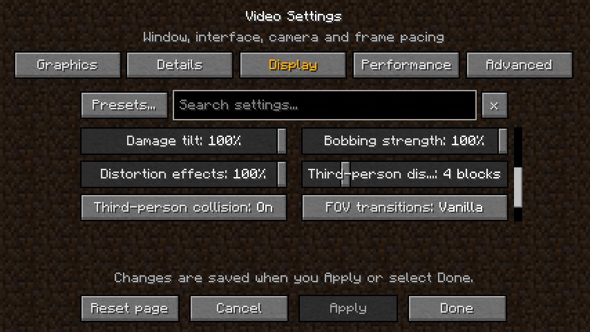
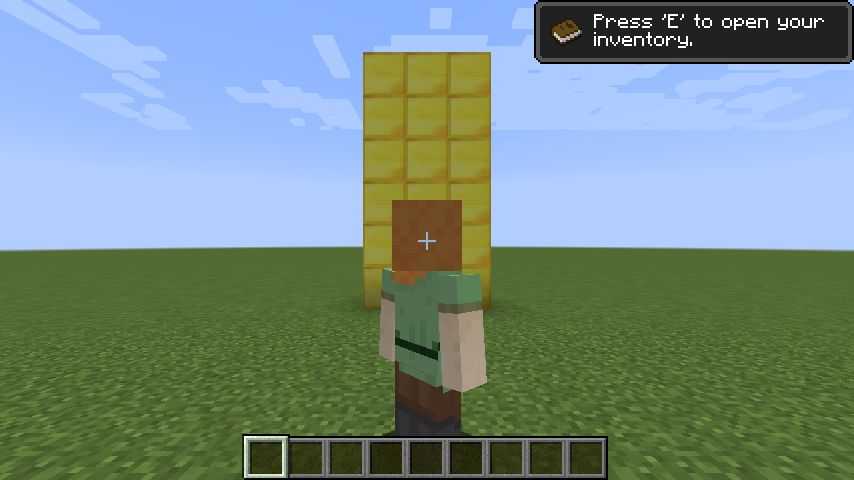
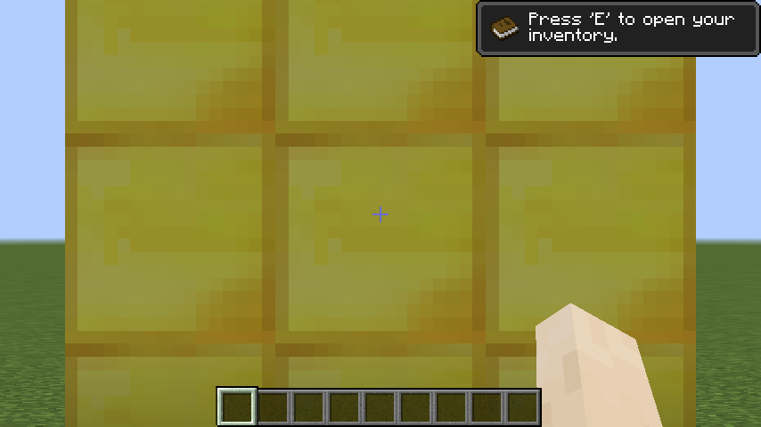

Harness limitations: the front-view (second F5 view) reading at 8 blocks was
4.0 blocks, because the player had landed on the floor before that step and
the camera, which looks down at 20 degrees in front of the player, was stopped
by the ground; this is collision working, but it means front-view distance
was not checked in open air. `third-person-8.png` shows one unbuilt or culled
terrain section at the right edge, taken about 4 s after a teleport; it was not
investigated further. Not checked: hardware GPUs and Windows, a real
Nether portal and potion (the portal time and nausea were set directly), mouse
and keyboard input for zoom (the key state was set directly), multiplayer
servers, other mods.

## Local camera and scheduling follow-up, 2026-10-23

An independent local Docker/llvmpipe run preserved the cloud evidence above.
Its refined temporary camera harness leveled the front view after landing:
8 and 4 blocks produced x offsets +7.95 and +3.95, closing the earlier
front-distance validation gap in this local scene. Both full/readback attempts,
35 screenshots, numeric verification and a complete harness-free static/pan/fly
smoke are archived in the [local camera report](validation/2026-10-23-camera-settings/local-docker-rerun/README.md).
All 162 tests and a clean Java 25 build passed; shipping sources match the
pre-launch freeze, and binary/source jars contain no temporary harness.
Physical key input, other mods and hardware-driver validation remain open.

The independent 16-launch local scheduling series failed G1, G2 and G6, while
the cloud series failed G3 and G5. The two environments and their results are
kept separate; see the [local results and limitations](benchmarks/2026-10-23-chunk-scheduling/local-docker-rerun.md).
Both experiments remain off by default and outside `render.defaults`. The
reference-hardware series with worker feeding as a third arm, and an automatic
thread-count policy, remain deferred.

## Validation, 2026-10-23: expanded settings

Evidence is in [validation/2026-10-23-video-settings-expansion](validation/2026-10-23-video-settings-expansion/). This was a Linux cloud container, not the
reference Windows machine: Temurin 25.0.5+8, Xvfb at 1280x720, Mesa 25.2.8
llvmpipe (software OpenGL 4.5), 4 CPU threads, no GPU. Timings below are
indicative only and not comparable to the benchmark archives. No frozen
benchmark protocol, threshold, baseline or archive was changed.

**Build and unit tests.** `clean build --offline` with `JAVA_HOME` set to that
JDK: 138 tests (123 before this change), no failures, errors or skips; 196 main
classes at classfile version 69, none from the temporary harness. New tests
cover every new value rule at and away from its default (bit-for-bit vanilla
floats and doubles at defaults), menu/config default agreement, persistence and
live update, relaunch read-back, restart-only chunk threads, invalid menu
values (rejected, file unchanged), clamped and step-rounded file values,
launch-override locking, benchmark defaults, labels, categories, search, the
experimental markers, the presets (validity, scope, staging only editable
settings, never selecting an experimental value) and the atlas-border rules
(width, edge repetition at every mip level, buffer reuse, when a layout change
needs a texture reload). After the anisotropic-filtering follow-up: 141 tests, no failures, errors
or skips; 205 main classes at classfile version 69, none from the harness.

**Real client.** A temporary harness ([ExpansionCheck.java](validation/2026-10-23-video-settings-expansion/ExpansionCheck.java),
not shipped) changed settings through `VideoSettingsBackend.apply`, the menu's
Apply path, in a fresh superflat spectator world. Launches: `full` (twice; the
first run's screenshots were lost to a missing folder and its particle-limit
result exposed a bug, below), `particles` (twice, before and after the fix) and
`readback` (twice). A final launch of the shipping build (harness removed)
reached the title screen without mixin or injection errors.

| Setting | Observed |
|---|---|
| Entity distance | Dropped items every 4 blocks (vanilla limit 16 blocks for items). Items drawn: 25% 0, 50% 1, 100% 3, 200% 7, 500% 15 (all loaded). Exactly the expected thresholds; 100% matched before and after. |
| Block entity distance | Chests every 8 blocks: 25% shows only the nearest chest, 100% shows chests to 64 blocks, 300% shows the rest of the lane. |
| Biome blend | Client chunks split into jungle and ice plains: Off gives a hard edge, 3x3 a narrow gradient, 7x7 a wide one. Terrain rebuilt after each Apply. |
| Distance fog | 30% visibly hazier horizon; Off shows a crisp terrain edge and unfogged distant clouds. |
| Sun and moon | Off removes the sun (noon) and moon (midnight) including the sun's halo; sky color, stars and clouds unchanged. |
| Animations | With each group Off, frame and frame-tick counters of water, lava, fire, portal, sea lantern and prismarine sprites were unchanged over 80 frames; with On they advanced. With Other animations Off the clock sprite still moved (frame 0 to 31 after `/time set 18000`). |
| Particle limit | Per-list census while spraying 400 redstone particles per frame: lists held exactly 4000, 250, 1000 and 4000. |
| Anisotropic filtering | Driver reports the extension, maximum 16. Atlas parameter read back: 1.0 at Off, 16.0 at 16x, still 16.0 after a full resource reload, 1.0 after returning to Off. The first build showed seams; see the atlas-border fix below. |
| FOV effects | Flying spectator's interpolated FOV multiplier: 1.0999999 at 100%, 1.05 at 50%, 1.0 at 0%, back to 1.0999999. |
| Damage tilt | With the hurt timer held, 100% tilts the horizon; 0% leaves it level. |
| Chunk update budget | Time to rebuild all terrain after `WorldRenderer.reload()` at render distance 8: 25% took 8.1-10.9 s; 400% took 0.06-0.86 s (two runs each, two launches). Mean frame time while settling was about 30 ms for both; the 25% runs had the larger worst frames (48-101 ms vs 18-51 ms), so this scene did not show the extra spikes a higher budget can cause. |
| Chunk builder threads | Saved 4: running count stayed 2 with the gold restart notice; after relaunch 4 "Chunk Batcher" threads and 7 buffer sets (vanilla 2 and 5). Restoring 2 was saved and again marked restart-required. |
| Performance overlay | On shows the overlay immediately; Off hides it. |
| Presets | Performance, Enhanced and Vanilla applied through the draft and Apply; every preset key matched live values afterwards, and render distance stayed 8. |
| Persistence | Non-default values saved in one launch were read back by a fresh JVM, then restored to defaults through Apply in that JVM. |

**Bugs found and fixed during validation.**

- *Particle limit did not shrink full lists.* After lowering the limit,
  continuous spawning kept a list at its old size (2250 at a 250 limit):
  vanilla's one-for-one eviction removes the oldest particles before they can
  expire. A list above the limit is now cut back to it in one step at its next
  addition; at the vanilla limit lists never exceed 4000, so vanilla's single
  removal is unchanged. The fixed census is above.
- *Preset dialog drew setting rows over its text.* Setting-row ids passed the
  dialog's button check, so rows were drawn on top and hovering one could have
  indexed past the preset list. The check now uses the exact id range
  ([before](validation/2026-10-23-video-settings-expansion/menu-presets-before-fix.png), [after](validation/2026-10-23-video-settings-expansion/menu-presets-fixed.png)).

**Anisotropic filtering: seams found, then fixed with atlas borders.** The
first build drew dark lines at block edges and sparkle at the horizon at 16x,
where samples reached neighboring sprites in the atlas, so it shipped marked
experimental. The follow-up adds sprite borders (described above). A
same-scene comparison (water pool, stone and grass at a grazing angle) used the
bordered build and a control build identical except for borders forced off
(not committed):

| Build | Atlas | Dark-seam pixels below the horizon |
|---|---|---:|
| Filtering Off | 512x512 | 0.157% |
| 16x, control without borders | 512x512 | 1.794% |
| 16x, with borders | 2048x1024 | 0.148% |
| 4x, control without borders | 512x512 | 1.679% |
| 4x, with borders | 2048x1024 | 0.146% |

The metric counts pixels darker than 70% of their 9x9 median. Read-backs in the
bordered build: atlas 512x512 with filtering Off, 2048x1024 after turning it
on (texture reload), the stone sprite moved inside its 16-texel border with
coordinates covering only the sprite; 16x to 4x changed only the parameter
(no reload); a full resource reload kept the border and 4x; water kept
animating with its border; turning filtering Off restored the 512x512 vanilla
layout. A stitcher limited to 256x256 holding 40 bordered 16x16 sprites fell
back to an unbordered 128x128 layout with the warning instead of failing.
llvmpipe still smooths nearby textures under anisotropy, which is that driver's
documented choice. The fix was not checked on a hardware GPU. Mean frame time
at 16x was the same with and without borders (52.5 and 52.4 ms over two
alternating blocks each; about 40 ms with filtering off); llvmpipe's software
filtering dominates that cost.

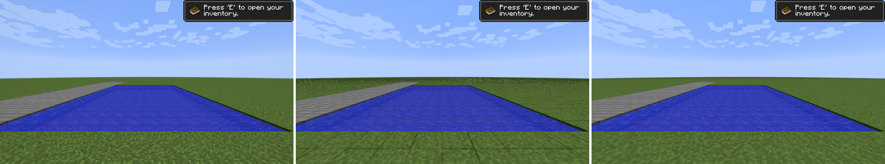
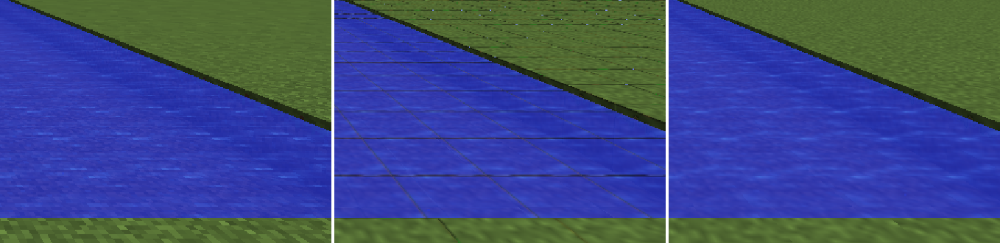

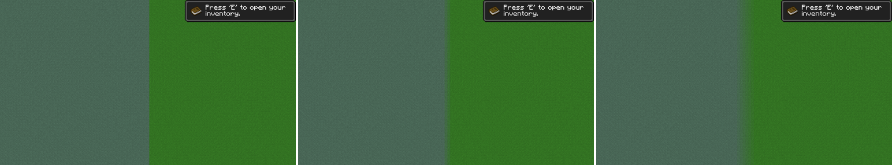
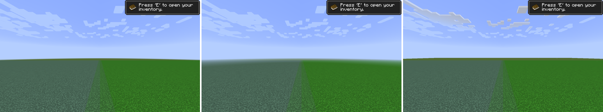
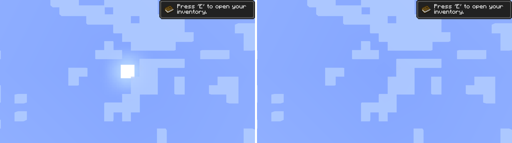
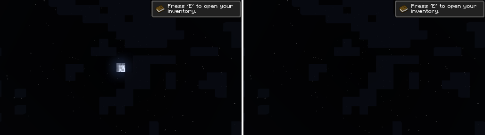
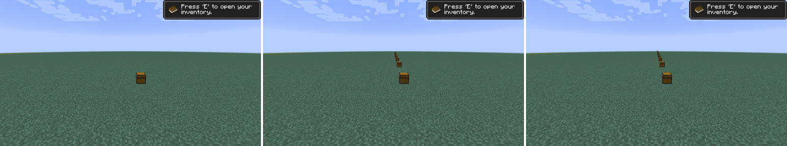
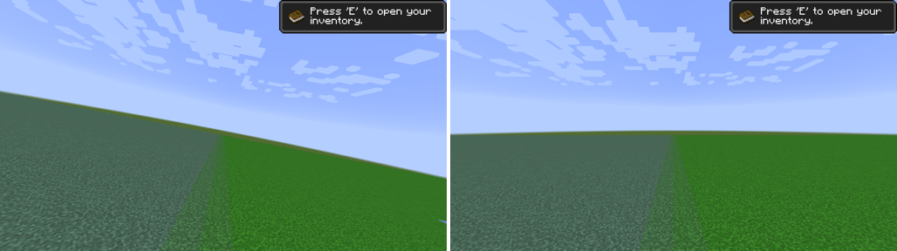
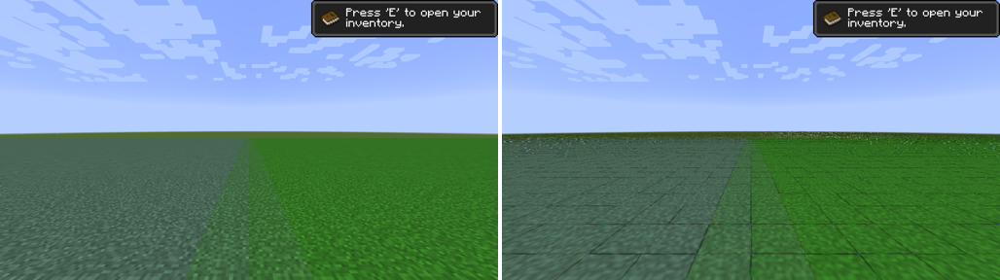
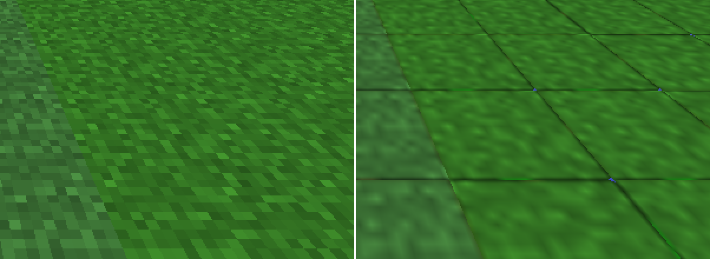
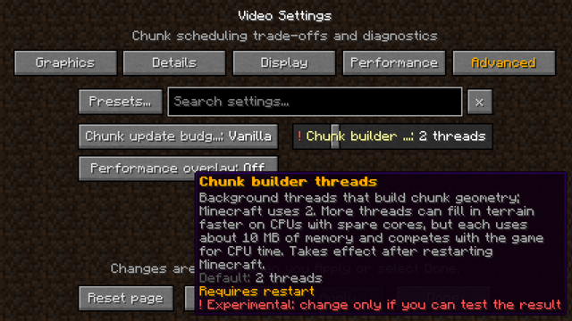
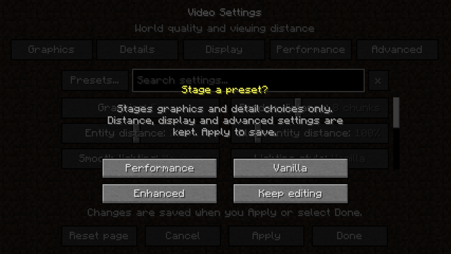

**Indicative frame time.** Alternating A/B blocks (ABBA), 4 blocks per choice
after a settle period, FPS uncapped, VSync off, render distance 8. One session
on software rendering, not a benchmark series.

| Comparison | Scene | Mean frame time | Change | Blocks agreeing |
|---|---|---|---|---|
| Particle limit 4000 -> 250 (fixed build) | 400 redstone particles spawned per frame | 47.23 -> 35.19 ms | -12.0 ms (-25%) | 4/4 |
| Particle limit 4000 -> 250 (before the fix; lists not trimmed) | same | 49.94 -> 44.00 ms | -5.9 ms | 4/4 |
| Anisotropic filtering Off -> 16x, launch 1 | flat ground at a grazing angle | 38.00 -> 52.01 ms | +14.0 ms (+37%) | 4/4 |
| Anisotropic filtering Off -> 16x, launch 2 | same | 36.66 -> 50.33 ms | +13.7 ms (+37%) | 4/4 |

Anisotropic filtering is far more expensive in software than on GPUs with
texture units built for it; treat its cost here as an upper bound for this
renderer only. Biome blend rebuild times in a superflat world were all
0.3-0.5 s and do not measure its chunk-build cost; a terrain-heavy chunk-build
timing on the reference machine is the follow-up if that cost matters.

Not checked: hardware GPUs and the reference machine, Windows, other GUI
scales and window sizes for the five-tab row, complete keyboard-only operation
of the preset dialog, the Nether's thick fog with Distance fog Off, beacons,
resource packs with custom animations, other mods, non-English localization,
and the frame-time effect of more than two chunk builder threads.

## Validation, 2026-10-22: split Graphics and new Details controls

Evidence is in [validation/2026-10-22-video-settings](validation/2026-10-22-video-settings/).
This was a Linux cloud container, not the reference Windows machine:
Temurin 25.0.5+8, Xvfb at 1280x720, Mesa llvmpipe software OpenGL 4.5, 4 CPU
threads. No GPU, so the timings below are not comparable to the benchmark archives.

**Build and unit tests.** `clean build --offline` with `JAVA_HOME` set to that JDK:
110 tests, no failures/errors/skips; 175 main classes at classfile version 69.
New tests cover menu/config default agreement, persistence and live update,
invalid values, clamping, launch-override locking, benchmark defaults, labels,
effects and search.

**Real client.** A temporary harness ([VisualCheck.java](validation/2026-10-22-video-settings/VisualCheck.java),
not shipped) created a fresh superflat spectator world. It changed each setting
through `VideoSettingsBackend.apply`, the menu's Apply path, and took screenshots
in place. Four launches: `full`, `readback`, `rerun`, `vignette`. A final smoke
launch of the shipping build (harness removed) reached the title screen without
mixin or injection errors.

| Setting | Observed |
|---|---|
| Rain splashes | Mean live particles in rain over 200 frames: Fancy 653.5, Fast 163.7, Off 0.0, Follow Graphics 654.7 (Graphics Fancy) and 163.4 (Graphics Fast). |
| Vignette | Under a 31x31 roof: corner mean 0.159 Off, 0.087 On, 0.087 Follow Graphics (Fancy), 0.151 Follow Graphics (Fast); centre unchanged. At noon or night outdoors vanilla's vignette is effectively invisible (the client world keeps full sky light), so the overlay costs frame time there without visibly changing the image. |
| Stars | Midnight sky: stars absent with Off; moon, clouds and sky colour unchanged. |
| Enchantment glint | Off removes glint from a dropped enchanted sword and golden apple and from an armor stand's enchanted armor; On restores it. |
| Dropped items | Fast draws one model per stack; Fancy draws the vanilla copies (up to five). A single apple looks the same in both. |
| Persistence | Non-default values saved in one launch were read back by a fresh JVM (startup log and menu), then restored to defaults through Apply. |

**Indicative frame time.** Alternating A/B blocks (ABBA order), 4 blocks of 300
frames per choice after a settle period, FPS uncapped, VSync off, render distance 8.
This is one session on software rendering, not a benchmark series. Leaves (an
existing control) is included for scale.

| Comparison | Scene | Mean frame time | Change | Blocks agreeing |
|---|---|---|---|---|
| Rain splashes Fancy -> Off | rain, ~650 splash particles | 69.39 -> 64.93 ms | -4.46 ms (-6.4%) | 4/4 |
| Vignette On -> Off | open field, day | 39.97 -> 36.14 ms | -3.83 ms (-9.6%) | 4/4 |
| Dropped items Fancy -> Fast | 300 dropped full stacks | 51.13 -> 42.23 ms | -8.89 ms (-17.4%) | 4/4 |
| Enchantment glint On -> Off | 300 dropped enchanted swords | 50.92 -> 45.13 ms | -5.79 ms (-11.4%) | 4/4 |
| Leaves Fancy -> Fast | 13x7x2 leaf wall | 46.46 -> 43.17 ms | -3.29 ms (-7.1%) | 4/4 |

Stars were not timed: they are a single display list. The first run's dropped-item
and glint blocks are excluded. 1.8.9's `ItemEntity.setNeverDespawn()` only delays
despawning by five minutes, so the grids vanished mid-measurement; this shows
in `results-full.txt`. The rerun pinned item age to vanilla's never-despawn value.
Entity counts were identical before and after each series.

Not checked: snow, rain-splash smoke over lava, the world-border warning tint,
potion glint in a held item, resource packs, other GUI scales, other drivers and
the reference hardware. On a GPU, the full-screen vignette and fill-heavy passes
may cost proportionally less or more than under llvmpipe.

## Validation, 2026-10-21

`JAVA_HOME=C:/Program Files/Eclipse Adoptium/jdk-25.0.4.101-hotspot` was explicit
for builds, tests and the game. `test build --offline --console=plain` passed:
98 tests, no failures/errors/skips; 165 main classes at classfile version 69.
The actual game executable and command line were checked: the specified JDK's
`bin/java.exe`, Java 25.0.4.1, `--enable-native-access=ALL-UNNAMED`,
`-XX:StackShadowPages=32`, and `-Xmx2G`, with Mixin diagnostics for these checks.

Six serial UI attempts were retained with unique logs at
`build/settings-ui-live-r1.log` through `r6.log`. Attempts 1 and 2 failed because
the leaf reload selector did not resolve; the final `reload()V` descriptor fixed
the injection. Attempts 3 and 4 exercised the initial menu and in-world apply;
5 checked the vanilla-widget redesign; 6 checked the formatting-code theme.
Builds happened before launches, and sources were not edited while clients ran.

Live checks used `build/settings-ui-client`, with a dedicated copy of the
benchmark base world for the in-world smoke test. These were interactive checks,
not measured flights. The normal user's paused client was saved and closed with
permission before serial testing. Its settings/world were not used for UI edits.

Observed live: opening from title and in-world Options; global search; staged
values staying off disk until Apply; Keep Editing retaining pending changes;
scoped reset staging defaults; persistence across relaunch; GUI scale application;
leaf/weather application with an active world and terrain reload; yellow pending,
gold restart and green saved messages; restart preference reversion clearing the
notice. No selected application, injection or GL error was reported in successful
attempts. The legacy Realms missing-class startup warning remains separate.

The final color check saved particle vertex writing Off and then restored On,
and restored both quality overrides to Follow Graphics in the isolated config.
Unit tests separately cover retained live startup state, next-load preference,
save failures, malformed files, JVM override precedence, benchmark read-only
behavior, reset scoping, global search and independent quality selection.

Remaining checks include rainy/snowy-biome visual comparisons, leaf appearance
across resource packs/backends, fullscreen and monitor changes, every GUI scale,
complete keyboard-only operation, live read-only/save-failure UI, other mods and
non-English localization. There is no new frame-time or pixel-equivalence claim.
Frozen benchmark archives, prior runners and Java 8 evidence remain unchanged.

Hashes, attempt outcomes and preservation checks are in
[validation.json](validation/2026-10-21-video-settings/validation.json).
