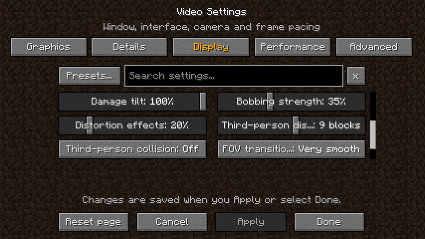

# Camera settings live validation, 2026-10-23

Six immediate Display controls were exercised in a real Minecraft 1.8.9 client:
view-bobbing strength, nausea/portal distortion, third-person distance and
collision, FOV transition rate and held zoom. Their existing defaults remain
100%, 100%, 4 blocks, collision On, Vanilla transition and 4x zoom; the zoom key
is unbound by default. No camera performance change was pursued: profiling had
found no qualifying camera cost.

## Method and attempts

This was the dedicated local Docker worktree on branch
`claude/magical-planck-7t9612`, starting from `5030c5f`; no normal user's game
settings or world were used. Java 25.0.5+8 selected the Gradle, compiler/test and
client runtimes. The client used Mesa 26.0.8 llvmpipe under Xvfb, 854x480, 2 GiB
heap and a four-CPU container quota. These are live software-client checks,
not Windows/GPU compatibility tests or performance measurements.

After the frozen benchmark series completed, `CameraCheck.java` was temporarily
copied to `src/main/java/net/adiont/alacer/devcheck/` and called at the end of
`Alacer.onFrameStart()`:

```java
if (CameraCheck.ACTIVE) CameraCheck.frame(Minecraft.getInstance());
```

The archived draft compiled without errors. It opens the real settings screen,
uses the same `VideoSettingsBackend.apply` path as Apply, creates a fresh flat
world, holds reproducible walking/effect/key state and records camera/FOV
readouts and screenshots. Launch commands (with `JAVA_HOME=/opt/alacer-jdk`):

```bash
LIBGL_ALWAYS_SOFTWARE=1 xvfb-run -a -s "-screen 0 1280x720x24" \
  bash ./gradlew runClient --offline --console=plain -Pwindow=854x480 -Pxmx=2G \
  -Palacer.cameraCheck=true -Palacer.cameraCheck.mode=full
# Relaunch with the same settings files:
LIBGL_ALWAYS_SOFTWARE=1 xvfb-run -a -s "-screen 0 1280x720x24" \
  bash ./gradlew runClient --offline --console=plain -Pwindow=854x480 -Pxmx=2G \
  -Palacer.cameraCheck=true -Palacer.cameraCheck.mode=readback
```

Both modes completed in both attempts, with `DONE` results and successful Gradle
exits. [attempt1/](attempt1/) preserves the original harness, logs, results and
17 screenshots. Its downward-looking front view clipped against the floor after
the player landed: its offset was collision-limited, so it could not establish
the requested 8-block distance. The final harness levels that view after a
teleport and measures both 8 and 4 blocks. No shipping camera code changed.

The final [full log](camera-full-2.log), [readback log](camera-readback-2.log),
[results-full.txt](results-full.txt), [results-readback.txt](results-readback.txt)
and all 18 [screenshots](screenshots/) are retained. `saved-after-full.properties`
and `restored-after-readback.properties` retain the saved and restored config.

## Observed behavior

| Check | Real-client observation |
|---|---|
| Menu, tooltip and search | Display showed the new controls; the collision tooltip included default/application help; global search for zoom returned its magnification control. Readback displayed the saved non-default values. |
| Bobbing | At one held walking phase, the camera offset's z component was 0.05000 / 0.02500 / 0.00000 at 100% / 50% / 0%. The 0% vector matched vanilla View bobbing Off; returning to 100% restored the initial vector. |
| Distortion | With nausea and portal time held at 0.8, 100% and 50% visibly stretched the scene; Off looked like the separate no-effect control. This is visual inspection, not a pixel-equivalence assertion. |
| Rear third person | 1, 4, 8 and 16 blocks changed the view as expected and restored 4. At a 20-degree pitch the camera-offset x components were about -0.893, -3.712, -7.471 and -14.988. |
| Front third person | With a level view, x offsets were +7.95000 at 8 blocks and +3.95000 at 4: a 4-block change with collision enabled and no blocking geometry. |
| Wall collision | At distance 4, On limited x to -2.45400; Off allowed -3.95000, putting the camera inside the wall. Returning On restored the clipped offset. Screenshots show the outside and wall-interior views. |
| FOV transitions | Flying targets modifier 1.1. Instant reached it at the next observed update; Vanilla approached by 1/2, Smooth by 1/4 and Very smooth by 1/8 of the remaining difference. Returning Vanilla restored its rate. |
| Zoom | Simulated held key: world FOV about 17.5 / 35 / 8.75 at 4x / 2x / 8x, with hand FOV 70 throughout. Release restored world FOV 70 and `pressed=false`. The harness unbound the temporary C binding. |
| Persistence and restart state | Saved 35%, 20%, 9 blocks, collision Off, Very smooth, 8x. A new process read every value back with `restartRequired=false`, then restored all six defaults. |

`Camera.offset()` includes vanilla eye height and its 0.05-block camera offset;
its logged vector length is **not** the configured third-person distance. FOV
samples are observed when world time changes; the final Smooth series repeated
one renderer sample. The verifier counts that duplicate and checks the resolved
transitions, without claiming a complete per-tick trace. Short frame-based waits
also leave small FOV interpolation residuals (4x logged 17.500002).

The reproducible readout and PNG-dimension checks pass:

```bash
python3 -I docs/validation/2026-10-23-camera-settings/local-docker-rerun/verify-readouts.py
```

Screenshots were also inspected for the menu, tooltip/search, bobbing, distortion,
rear/front views, collision and zoom. Those observations are separate from the
numeric verifier; it does not judge screenshot appearance.

## Shipping build and smoke

The harness and its frame hook were removed before `bash ./gradlew clean build
--offline --console=plain`. The shipping `src/` hashes match the benchmark
`rerun-freeze.json` byte-for-byte. The clean build passed all **162 tests** (zero
failures/errors/skips), access-widener validation and jar remapping. The packaged
classfile target is Java 25 (major 69), and neither the binary nor source jar
contains `devcheck` or `CameraCheck`. See [shipping-build.log](shipping-build.log)
and the jar hashes/check results in [validation.json](validation.json).

The final harness-free development client smoke uses the ordinary benchmark
static/pan/fly route only to load a world, render and exit automatically. Its
[shipping-smoke.log](shipping-smoke.log) and `shipping-smoke.summary.json` record
the outcome. This is a smoke check of shipping sources after the clean build,
not a performance comparison or an independent external-launcher jar test.

## Remaining limits

The harness injects walking, nausea/portal and key state programmatically. It
checks the backend and real renderer, but not physical key rebinding, every
keyboard-only menu path, a naturally entered Nether portal, all player/effect
combinations, other mods, resource packs, GUI scales or hardware drivers. No
vanilla/default framebuffer equivalence or new camera performance claim is made.
The existing pure-rule/config/menu tests and build results prove different things
from these live observations. Headless OpenAL fallback, legacy Twitch/Realms and
log4j startup warnings remain in the retained logs.


